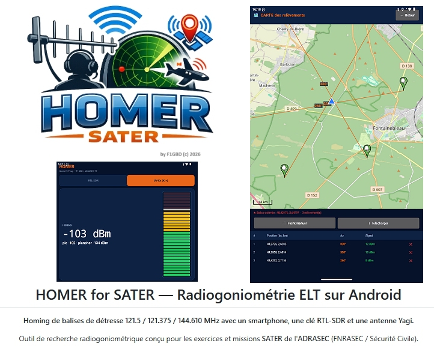
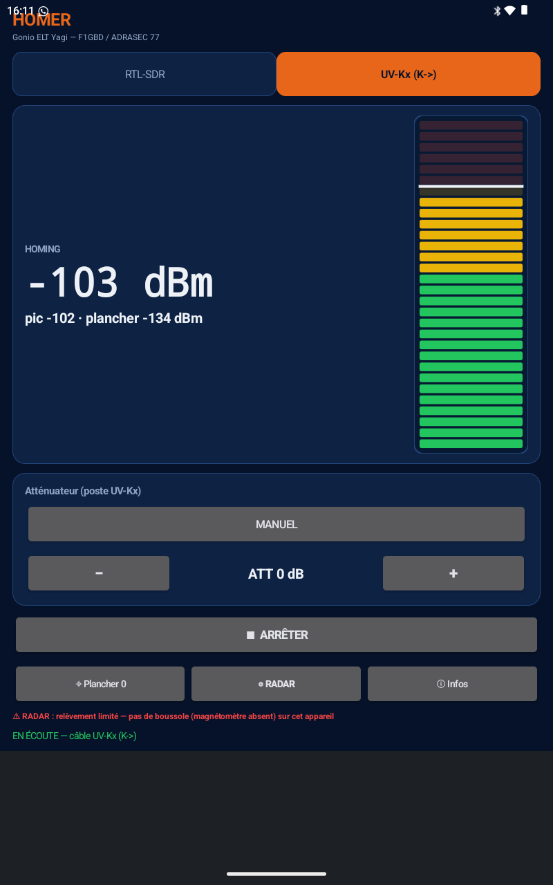
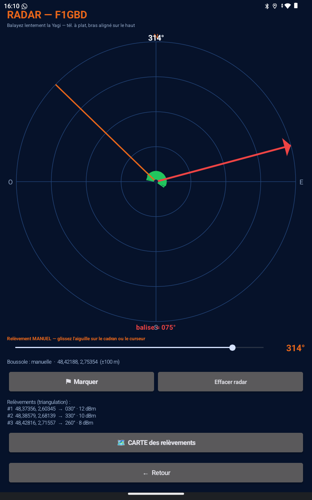
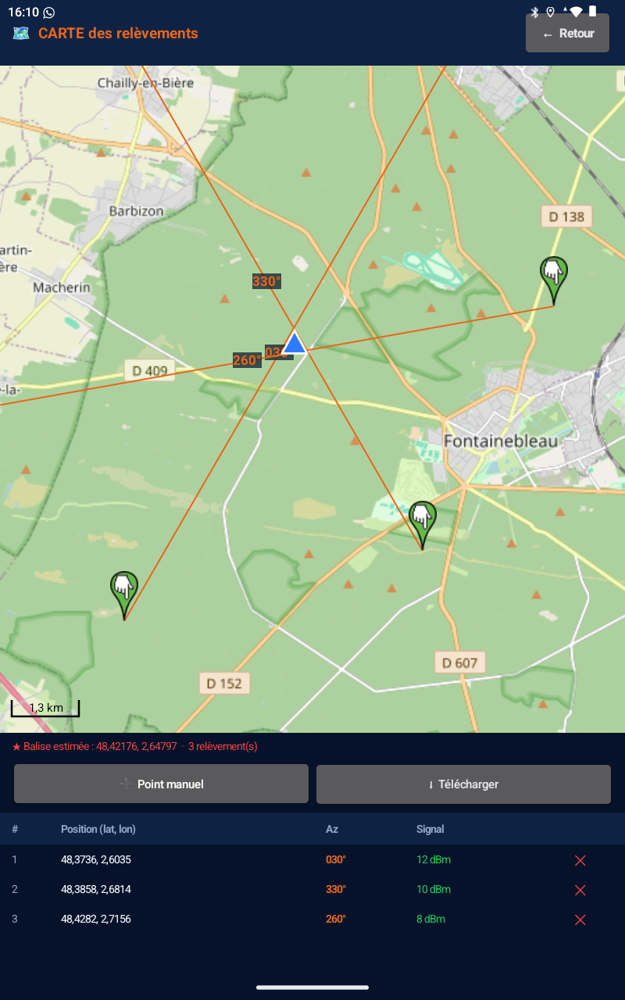
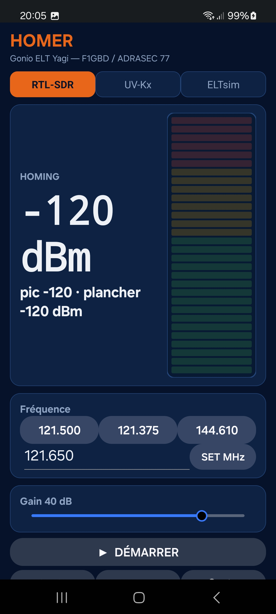
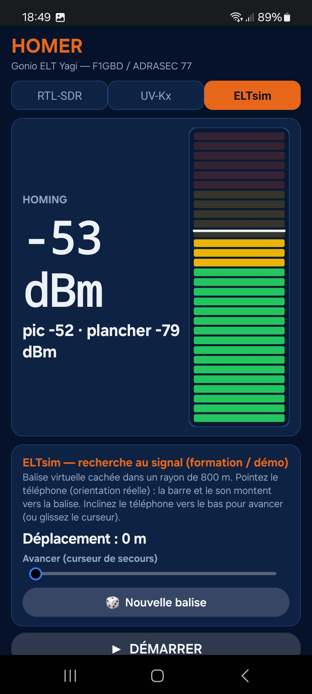
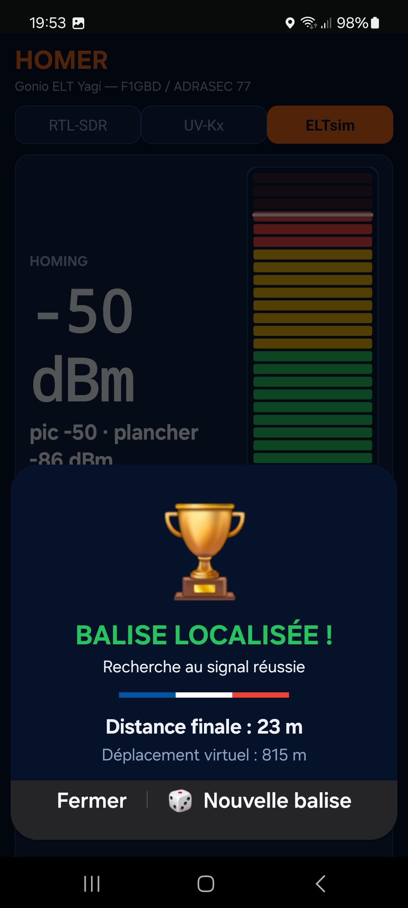

# HOMER for SATER — Radiogoniométrie ELT sur Android

**Homing de balises de détresse 121.5 / 121.375 / 406 MHz avec un téléphone Android, une clé RTL-SDR *ou* un UV-K1/K5, et une antenne Yagi.**

Outil de recherche radiogoniométrique conçu pour les exercices et missions **SATER** de l'**ADRASEC** (FNRASEC / Sécurité Civile).

  

### 📥 [Télécharger directement l'APK (v2.1.0)](https://github.com/f1gbd/F1GBD/releases/download/homer-android-v2.1.0/HOMER_android-2.1.0.apk)

---

## 🆕 Nouveautés v2.1.0

- **🎓 Nouveau mode ELTsim (formation / démo)** — entraînement à la **recherche au signal sans balise réelle**. Une balise virtuelle est tirée au hasard dans un **rayon de 800 m** ; on la cherche en se déplaçant : on **avance en inclinant le téléphone vers le bas**, la direction suit l'**orientation réelle** du téléphone. Guidage par le **bargraphe**, le **radar** et un **son de balise ELT** proportionnel au niveau (distance + alignement de la Yagi simulés) ; **coupe et fanfare de victoire** à la localisation.

**Depuis la v2.0** — refonte complète en **Kotlin natif + Chaquopy** (même chaîne qu'EPIRBdecoder Android), DSP en **NumPy pur** :

- **Deux sources au choix** sur un écran commun :
  - **RTL-SDR** en USB-OTG (driver *SDR Driver* de M. Marinov) ;
  - **UV-Kx** : un **UV-K1 / UV-K5** sous firmware **HOMER-RX** relié par le simple **câble de programmation (prise K)** — pas de clé SDR.
- **Atténuateur piloté depuis le téléphone** (mode UV-Kx) : **AUTO / MANUEL** et **pas ± en dB**, pour garder un relèvement net dans les tout derniers mètres.
- **Bargraphe vertical** segmenté (vert → ambre → rouge) **lisible en plein jour** + maintien du pic.
- **Plancher de bruit auto-adaptatif** : au repos la barre se re-cale seule ; une bouffée de balise ressort.
- **Correctif anti-blocage SDR** : le flux ne se fige plus (fini « serveur RTL bloqué » au bout de quelques secondes).
- **RADAR polaire** (balayage de la Yagi), **boussole** et **GPS**, **marquage de relèvements** avec la **force du signal**.
- **CARTE OSM des relèvements** : tracé des droites d'azimut, **position estimée de la balise par triangulation**, coordonnées **DDD / DMS / MGRS**, **cache de tuiles hors-ligne**, et **création de relèvements à la main** (tests / simulation).
- **Sans boussole** (tablette) : **relèvement manuel** (curseur / aiguille sur le cadran).
- **Splash**, **À propos** et **vérification des mises à jour** intégrée.

---

## ✨ Présentation

**HOMER** transforme un téléphone Android en **goniomètre de campagne**. En balayant lentement avec une petite **antenne Yagi**, l'opérateur lit la direction de la balise sur un **bargraphe de homing** (relatif au plancher de bruit, lissé pour le « whoop » AM balayé des balises ELT), un **radar polaire**, puis trace et **triangule** la position estimée sur une **carte OpenStreetMap** utilisable hors-ligne.

Le niveau peut venir de **deux sources interchangeables** : une **clé RTL-SDR** en OTG, ou un **UV-K1/K5 sous HOMER-RX** via le câble de programmation — dans ce cas l'application pilote aussi l'**atténuateur** du poste.

---

## 🚀 Fonctionnalités

- **Homing** : bargraphe vertical relatif au plancher, lissage enveloppe-pic adapté à l'ELT, maintien du pic.
- **Source RTL-SDR** : canaliseur IQ bande étroite (offset tuning + NCO + décimation NumPy), presets 121.500 / 121.375 / 144.610 MHz + saisie manuelle, gain réglable (0–49 dB ou auto).
- **Source UV-Kx (HOMER-RX)** : lecture série 38400 bauds par la prise K ; atténuateur **AUTO/MANUEL** et **pas ± (dB)** commandés depuis le téléphone.
- **RADAR** : mémoire du niveau par azimut, aiguille de cap, repère rouge du maximum = direction de la balise.
- **Boussole** `TYPE_ROTATION_VECTOR` + repli accéléro/magnéto, **déclinaison automatique** (GPS). **Sans magnétomètre : relèvement manuel**.
- **GPS** natif + **⚑ Marquer** (position + azimut + signal) pour la triangulation.
- **CARTE OSM** : relèvements + triangulation (**moindres carrés**), **balise = triangle bleu** (DDD/DMS/MGRS au tap), **tableau éditable** (ajout/suppression/édition), **« Télécharger la zone »** pour le **hors-ligne**.
- **ELTsim (formation / démo)** : balise virtuelle tirée au hasard (**≤ 800 m**), **directivité Yagi** et affaiblissement en distance simulés, **déplacement par inclinaison** du téléphone (ou curseur de secours), **son de balise ELT** proportionnel au niveau, **dialogue + fanfare de victoire**. Ni balise ni matériel requis.
- **Mises à jour** vérifiées depuis GitHub (tag `homer-android-v…`).

---

## 📡 Matériel requis

| Élément | Détail |
|---|---|
| Téléphone | Android 8+ (API 24+), **arm64-v8a**, USB-OTG ; boussole + GPS pour le relèvement |
| Source A | **RTL-SDR** (Nooelec NESDR SMArt v5 / RTL-SDR Blog) + adaptateur **USB-OTG** + driver **SDR Driver** (Marinov) |
| Source B | **UV-K1 / UV-K5 v3** sous firmware **HOMER-RX** + **câble de programmation** (prise K) en OTG |
| Antenne | Yagi 121.5 MHz (ou 2 m pour 144.610) |

> Le mode **ELTsim** ne demande **ni clé ni poste** : seulement le téléphone (boussole + GPS conseillés pour l'orientation et le point de départ).

---

## 📥 Installation

1. Pour la source **RTL-SDR** : installer l'appli **SDR Driver** de Martin Marinov (`marto.rtl_tcp_andro`).
2. **[Télécharger l'APK HOMER v2.1.0](https://github.com/f1gbd/F1GBD/releases/download/homer-android-v2.1.0/HOMER_android-2.1.0.apk)** (ou page [Releases](https://github.com/f1gbd/F1GBD/releases), tag `homer-android-v2.1.0`).
3. Autoriser l'installation depuis cette source, installer l'APK.
4. Pour la source **UV-Kx** : flasher **HOMER-RX** sur le UV-K1/K5 (voir le dépôt [Quansheng](https://github.com/f1gbd/F1GBD/tree/master/quansheng)).

L'application vérifie elle-même les mises à jour (**ⓘ Infos → Vérifier les mises à jour**).

---

## 🧭 Utilisation

1. Lancer **HOMER**, choisir la source en haut : **RTL-SDR** ou **UV-Kx (K->)**.
2. **RTL-SDR** : choisir la fréquence, brancher la clé, **DÉMARRER**, autoriser l'accès USB.
   **UV-Kx** : brancher le câble K->, **DÉMARRER**, autoriser l'accès USB ; régler l'atténuateur (**AUTO** ou **± dB**).
3. Balayer lentement la Yagi : le **bargraphe** monte vers la balise ; **⌖ Plancher 0** re-cale le bruit si besoin.
4. **◎ RADAR** : balayer pour tracer les pétales ; l'aiguille rouge indique le relèvement. **⚑ Marquer** l'enregistre (déplace-toi et marque un 2ᵉ relèvement).
5. **🗺 CARTE** : les droites d'azimut se croisent sur la **balise estimée** (triangle bleu, coordonnées au tap). **Télécharge la zone** avant de partir pour l'usage hors-réseau.

> **Tablette sans boussole** : le radar passe en **relèvement manuel** — glisse l'aiguille sur le cadran ou le curseur.

### 🎓 ELTsim (formation / démo)

1. Choisir la source **ELTsim**, puis **DÉMARRER** : une balise virtuelle est cachée à ≤ 800 m autour de vous.
2. **Tournez-vous** avec le téléphone (orientation réelle) : le **bargraphe** et le **son** montent quand vous pointez vers la balise.
3. **Inclinez légèrement le téléphone vers le bas** pour **avancer** dans la direction visée (ou utilisez le curseur de secours).
4. À l'arrivée (< 25 m), **coupe de victoire** 🏆 + fanfare. **🎲 Nouvelle balise** pour rejouer.

 

---

## ⚠️ Notes & limites

- Le **cap** dépend du magnétomètre : calibrer (mouvement en 8), tenir le téléphone à plat, aligné avec le boom de la Yagi.
- La **triangulation** demande **≥ 2 relèvements** pris de **positions différentes**.
- Hors-ligne, la carte n'affiche que les zones **déjà téléchargées** ou déjà consultées.
- La source **UV-Kx** nécessite **HOMER-RX** flashé sur le poste et le **câble de programmation**.
- Le mode **ELTsim** utilise l'**orientation réelle** (boussole) : sans magnétomètre, viser via le radar et avancer au curseur.

---

## 📖 Documentation

- [Manuel utilisateur HOMER v2.1.0 (PDF)](documentation/HOMER_Manuel_Utilisateur_v2.1.0.pdf)

---

## 👤 Auteur & licence

**Jean-Louis — F1GBD / F4JHW** · ADRASEC 77 · FNRASEC
Développé pour la communauté ADRASEC / Sécurité Civile. Driver RTL-SDR : *SDR Driver* de Martin Marinov. Cartographie : OpenStreetMap (osmdroid).

**Licence** : [PolyForm Noncommercial 1.0.0](LICENSE) — utilisation gratuite pour un usage personnel ou radioamateur, et par les associations (ADRASEC, FNRASEC…), les organismes de sécurité civile et les services publics ; **tout usage commercial est interdit**. Les versions publiées avant octobre 2026 restent régies par la licence qui les accompagnait.

*HOMER for SATER © 2026 F1GBD.*  **73** 📻
