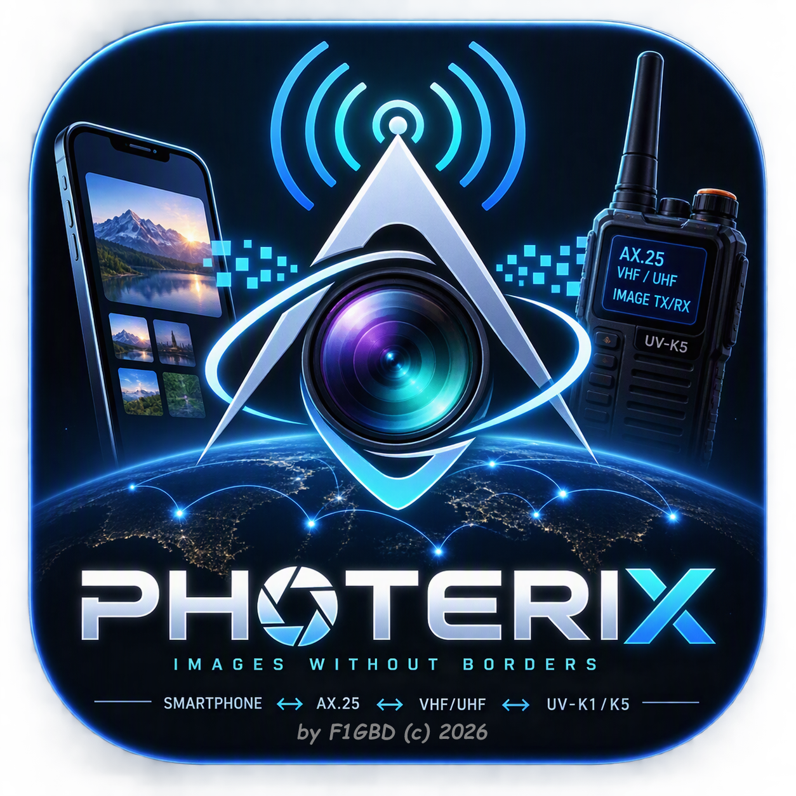
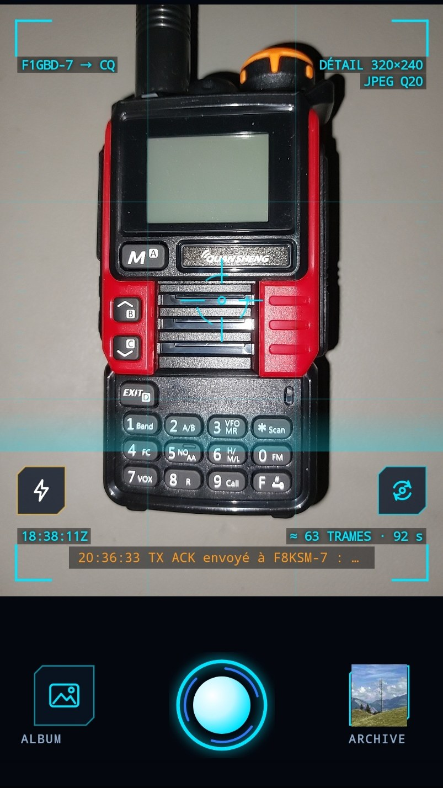
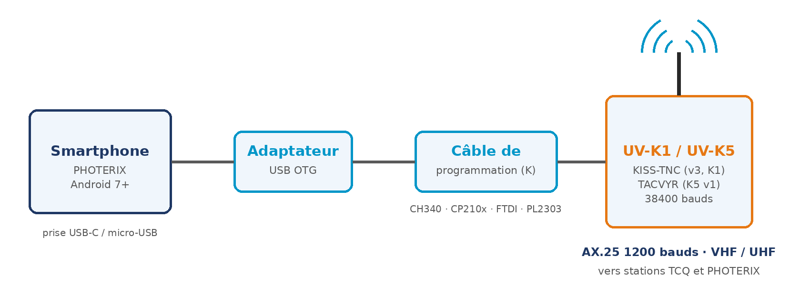
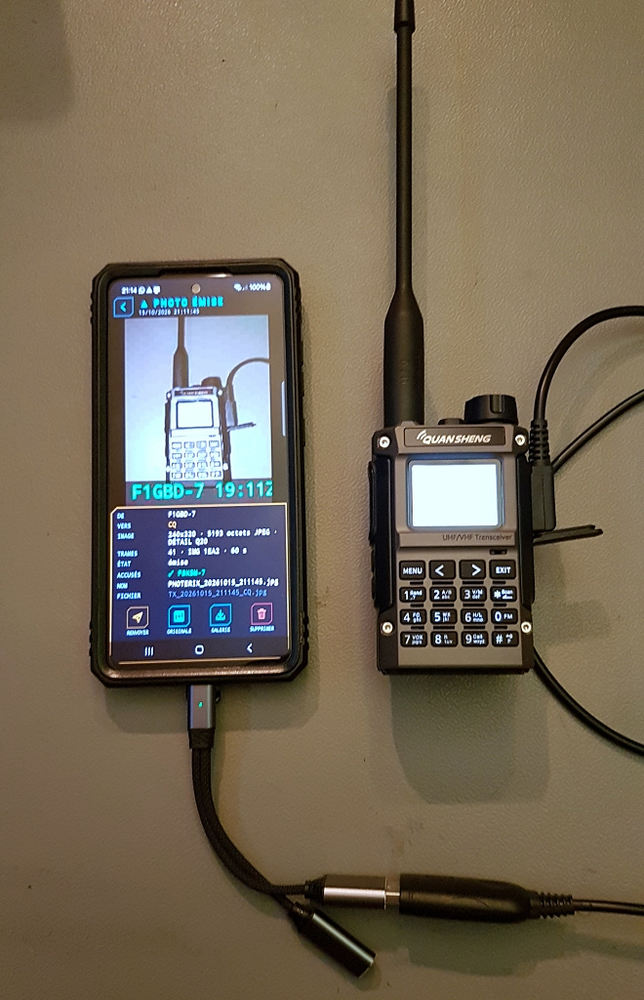
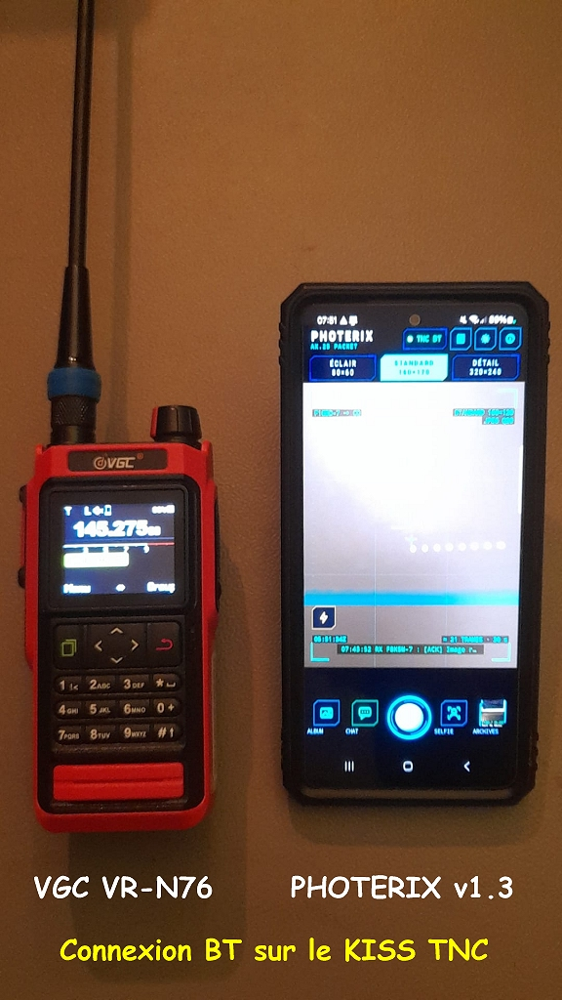
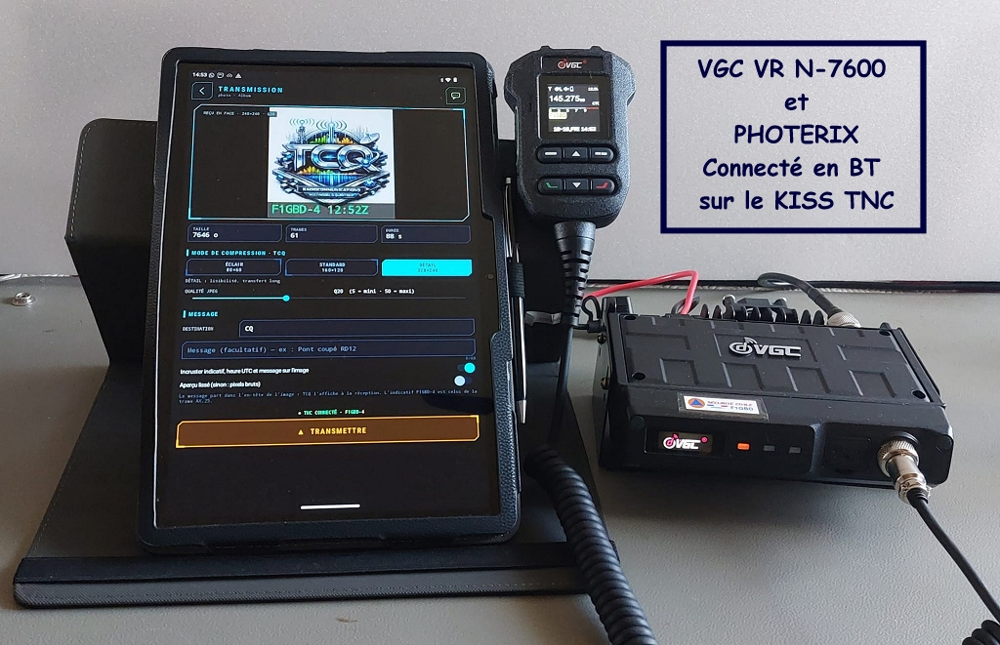

  

<h1 align="center">PHOTERIX</h1>

<b>Images sans frontières — des photos en Packet AX.25 VHF/UHF, du smartphone au portatif</b>

  <a href="https://github.com/f1gbd/F1GBD/releases/download/photerix-v1.4/PHOTERIX-1.4.apk"><b>📥 Télécharger PHOTERIX v1.4 (APK Android)</b></a>
  &nbsp;·&nbsp;
  <a href="documentation/MANUEL_PHOTERIX.pdf"><b>📚 Manuel (PDF)</b></a>

---

## 📸 En bref

PHOTERIX est une application Android qui permet à des opérateurs de **s'échanger des photos prises avec leur smartphone par radio**, en **Packet AX.25 1200 bauds**, en VHF ou en UHF, sans réseau mobile ni Internet.

Le smartphone est relié par **câble de programmation + adaptateur OTG** à un portatif Quansheng qui sert de TNC :

| Portatif | Application TNC sur la radio |
|---|---|
| UV-K1 / UV-K5 v3 (firmware F4HWN) | **KISS-TNC** |
| UV-K5 v1 | **TACVYR** (mode KISS) |
| VR-N76, VR-N7600, UV-Pro, GA-5WB | TNC KISS intégré, **en Bluetooth** (aucun câble) — testé en réel sur VR-N76 et VR-N7600 |

Le protocole image est **celui de TCQ** : une station **TCQ** et un smartphone **PHOTERIX** s'envoient leurs photos dans les deux sens, accusés de réception compris. Un poste de commandement sous TCQ reçoit donc directement les photos du terrain.

  

## ✨ Fonctions

- **Viseur plein écran** façon appareil photo, avec déclencheur, lampe et **zoom** de la caméra principale (pincer le viseur, pastille 1× · 2× · 4×).
- **Photo de l'album** du téléphone, ou **selfie** avec la caméra frontale (bouton SELFIE).
- **CHAT Packet** pour se coordonner avec les équipes avant et après une photo : messages en clair, lus et envoyés aussi par le chat TNC Packet de TCQ, phrases courantes d'un toucher, alerte des messages adressés à la station.
- **Message court** (60 caractères) et **indicatif de la station** joints à la photo ; en option, ils sont **incrustés** sur l'image avec l'heure UTC.
- **Trois modes de compression de TCQ** et qualité JPEG réglable de 5 à 50, avec **aperçu de l'image telle qu'elle sera reçue**, sa taille, son nombre de trames et sa durée d'émission.
- **Réception en direct** : l'image apparaît pendant qu'elle arrive, trame après trame ; alerte sonore et vibreur, notification écran éteint.
- **Accusés de réception** au format TCQ, dans les deux sens.
- **Archives locales** de toutes les photos émises et reçues : revoir, zoomer, **renvoyer**, **relayer** vers une autre station, copier dans la galerie.
- **Liaison maintenue écran éteint** : le téléphone en poche reçoit et accuse les photos.
- **Journal radio** des trames, accusés, messages et radiogrammes TCQ reçus.
- **TACVYR** dans le CHAT : messages tactiques courts, sans phonie, choisis par code comme sur le UV-K1 (9 rubriques × 9 phrases : « EQUIPE BRAVO SUR ZONE »).
- **RGRAM** dans le CHAT : **radiogramme ADRASEC authentifié** (TOTP + CRC), au format de TCQ, lu par les stations TCQ et, en option, par les pagers UV-K1 ; radiogrammes reçus vérifiés (CRC) et accusés par leur destinataire.
- **Position GPS en APRS** depuis le CHAT : TCQ place l'opérateur sur sa carte ; les positions reçues s'ouvrent sur une carte.
- **TNC Bluetooth** : VR-N76, VR-N7600, UV-Pro, GA-5WB (TNC KISS intégré, profil SPP), sans câble.
- **Accusés de réception étalés** : plusieurs stations à l'écoute ne se brouillent plus (avec TCQ v14.3.3).

## 🗜️ Les trois modes

| Mode | Résolution | Taille typique (Q20) | Trames | Durée ≈ |
|---|---|---|---|---|
| **ÉCLAIR** | 80 × 60 | ≈ 1 Ko | ≈ 9 | 15 s |
| **STANDARD** (défaut de TCQ) | 160 × 120 | ≈ 3 Ko | ≈ 23 | 35 s |
| **DÉTAIL** | 320 × 240 | ≈ 8 Ko | ≈ 65 | 1 min 40 |

Ce sont les résolutions de la fenêtre « Image Packet VHF » de TCQ. Une photo en portrait garde son sens (120 × 160 en STANDARD). Les durées comptent le TXDELAY de 800 ms et des trames enchaînées dans une seule émission.

## 🔌 Raccordement

  

1. Lancer **KISS-TNC** (UV-K1, UV-K5 v3) ou **TACVYR en mode KISS** (UV-K5 v1) sur le portatif, sur la fréquence Packet du réseau.
2. Brancher le **câble de programmation** sur la prise K du portatif et, par un **adaptateur OTG**, sur le téléphone.
3. Android propose d'ouvrir PHOTERIX : accepter (l'accès USB est alors accordé) — ou toucher la pastille **TNC** en haut de l'écran.

Câbles reconnus : CH340/CH341, CP210x, FTDI, PL2303 et CDC-ACM. Débit **38400 bauds** par défaut.

  

  

  

## 📡 Compatibilité TCQ

| | PHOTERIX → TCQ | TCQ → PHOTERIX |
|---|---|---|
| Trames | UI AX.25, PID F0, `{QI:ID:NN/TT:…` de 170 caractères | idem |
| En-tête | `IMG|<message ou nom>|<LxH>|<JPEG en Base64>` | `IMG|<fichier>|<LxH>|…` |
| Accusé | `[ACK] Image reçu le …` renvoyé par TCQ | renvoyé par PHOTERIX |
| CHAT | message en clair dans une trame UI, lu dans le chat TNC Packet de TCQ | idem |
| TACVYR | message tactique en clair (1 ou 2 phrases codées), vers CQ | idem, depuis un UV-K1/K5 |
| Radiogramme | `{QR:ID:NN/TT:…`, zlib + Base64, AUTH TOTP/CRC de TCQ (80 caractères en format pager UV-K1) | lu dans le CHAT, CRC vérifié |
| Position | balise APRS `=DDMM.mmN/DDDMM.mmE[…` vers APZPHX, sur la carte de TCQ | bulle 📍 dans le CHAT |
| Accusés | 3 à 14 s après la dernière trame, créneau au hasard, canal libre (TCQ v14.3.3) | idem |
| Paramètres KISS | TXDELAY 800 ms, Persistence 128, Slot Time 30 ms (TCQ v14.3.2) | |

Le message de l'opérateur voyage dans le champ « nom » de l'en-tête : TCQ l'affiche à la réception (« IMAGE reçue de F4JHW : Pont coupé RD12 »). Côté PHOTERIX, l'émission respecte la mémoire du TNC (900 octets au plus en attente, comme TCQ v14.3 en mode série).

Compatibilité vérifiée **au bit près** avec le code Packet de TCQ v14.3.2, dans les deux sens.

## ⚙️ Réglages

- **Station** : indicatif et SSID (7 par défaut, portatif).
- **Liaison TNC** : câble, débit, DTR/RTS, connexion automatique au branchement.
- **Paramètres KISS** : TXDELAY, Persistence, Slot Time (bouton « Valeurs de TCQ »).
- **Transmission** : destination par défaut, digipeaters, mode par défaut, incrustation, original pleine définition gardé, accusés automatiques.
- **Alertes** : son, vibreur, écran toujours allumé sur le viseur.

## 🗂️ Archives

Les photos sont rangées dans `Android/data/fr.f1gbd.photerix/files/Pictures/PHOTERIX` — lisible depuis un PC par le câble USB — avec le journal radio (`journal_radio.log`). Le fichier gardé est exactement le JPEG passé sur l'air ; pour une photo émise, l'original pleine définition peut être conservé à côté.

## 📚 Documentation

- **[Manuel d'utilisation et de paramétrage (PDF)](documentation/MANUEL_PHOTERIX.pdf)** — raccordement du portatif, réglages, émission, réception, archives, trafic avec TCQ, dépannage.

## 📱 Configuration requise

- Android 7.0 ou plus récent, avec **USB OTG**.
- Un portatif Quansheng sous KISS-TNC ou TACVYR, et son câble de programmation.

---

*Jean-Louis (F1GBD / F4JHW) — ADRASEC 77 — FNRASEC*
