# Quansheng UV-K1 / UV-K5 v3 — applications Sécurité Civile

Applications overlay (`.app`) pour le firmware F4HWN édition Labs, développées
pour les missions ADRASEC / FNRASEC, et leur outil d'installation.

### ▶ [Ouvrir l'UV-K1 Apps Uploader](https://f1gbd.github.io/F1GBD/quansheng/)

<p align="center">
  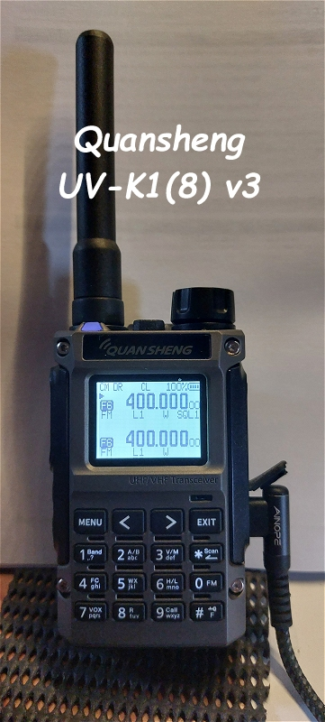
  &nbsp;&nbsp;
  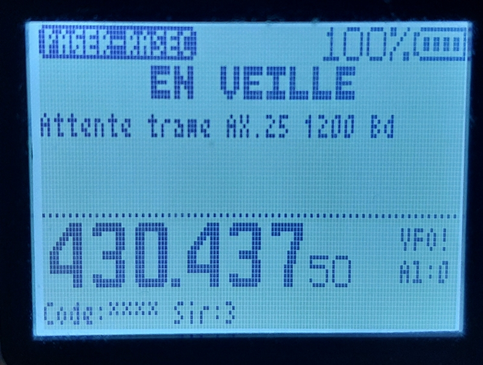
</p>
<p align="center"><em>Quansheng UV-K1(8) v3 et son écran sous firmware F4HWN</em></p>

## UV-K1 Apps Uploader

Page web d'installation par **Web Serial** (Chrome / Edge, ordinateur) :
**https://f1gbd.github.io/F1GBD/quansheng/** — elle ne demande aucun logiciel :
brancher la radio, choisir l'application, installer.

> Le lien `github.com/.../blob/master/quansheng/index.html` n'affiche que le code
> source de la page : utilisez l'adresse GitHub Pages ci-dessus.

<p align="center">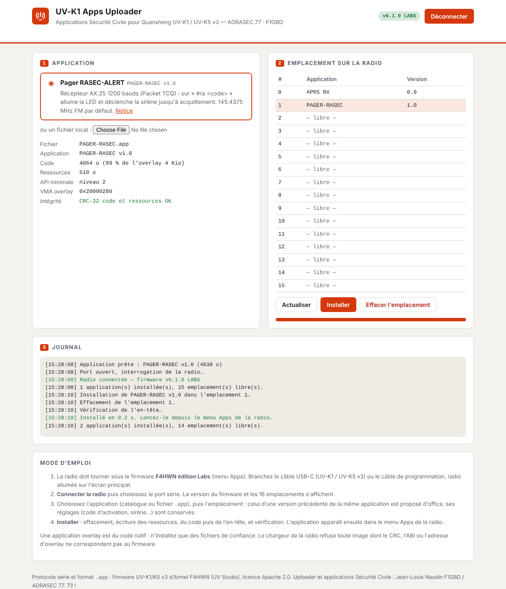</p>

- Lecture de la version du firmware et des 16 emplacements Apps de la radio.
- Catalogue des applications de ce dépôt (`apps/manifest.json`) ou fichier `.app` local.
- Contrôle du fichier avant envoi : signature FAP1, ABI, tailles, CRC-32 du code et des ressources.
- Installation : effacement, ressources, code, en-tête en dernier, vérification.
  Une mise à jour garde les réglages de l'application.
- Effacement d'un emplacement.

Le protocole (commandes 0x0514, 0x0730 à 0x0737) est celui du firmware d'Armel
F4HWN, également utilisé par UV Studio ; il est implémenté dans [`uvproto.js`](uvproto.js).

## Essai sur l'air

Premiers essais réussis le 9 octobre 2026 : TCQ (TNC Packet, Direwolf) envoie
`#RA ADRASEC77` depuis F1GBD-3, le UV-K1 sous PAGER-RASEC déclenche l'alerte
(écran, LED, sirène) puis affiche « ALERTE recue » après acquittement.

<p align="center">
  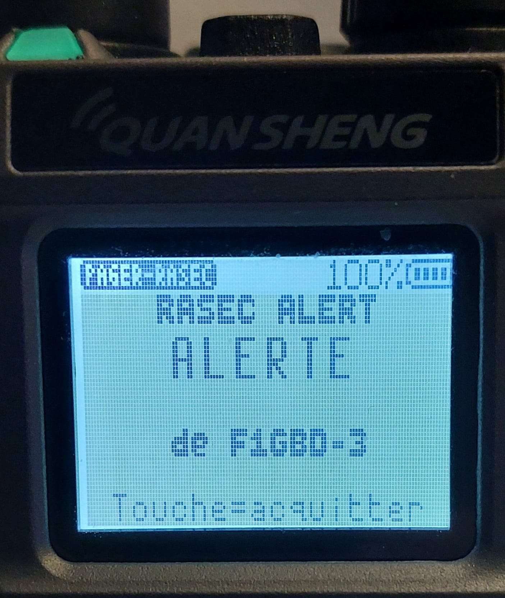
  &nbsp;&nbsp;
  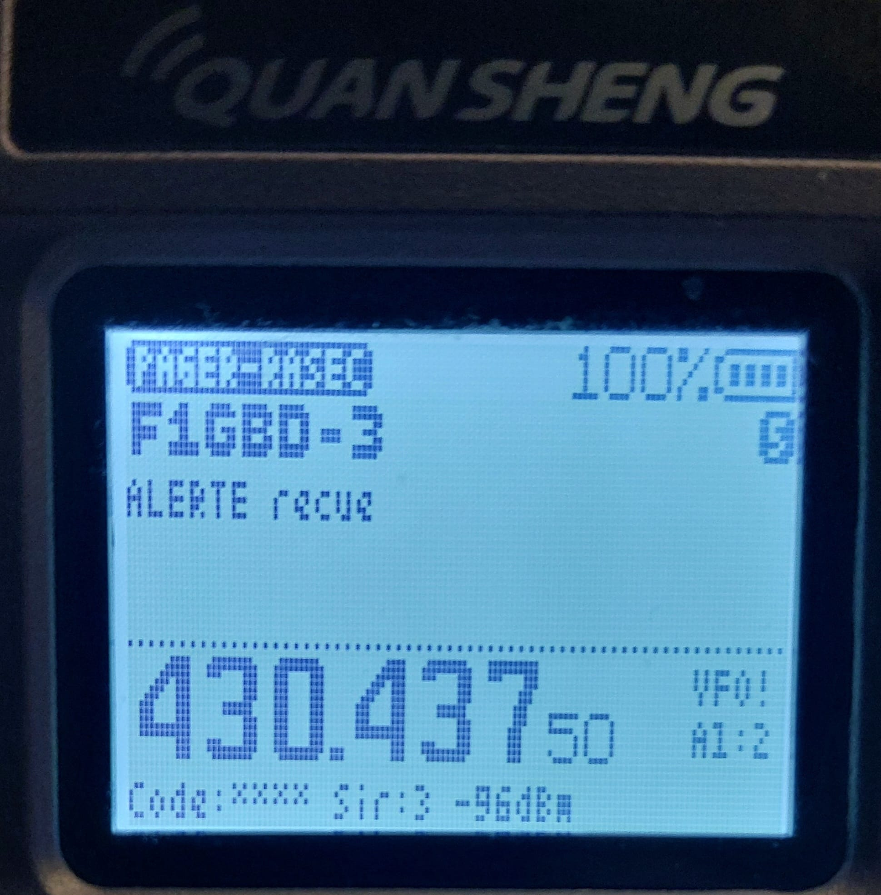
</p>
<p align="center"><em>À gauche : l'alerte reçue de F1GBD-3. À droite : l'écran de veille après acquittement
(PAGER-RASEC v1.0, VFO sur 430.4375 MHz, signal −96 dBm, 2 alertes).</em></p>

Puis le décodage CHAPPE26 : TCQ envoie `!1000 !1024 !1376 !1380 !1032 !1349 !1333 !1354 !1990`,
le UV-K1 l'affiche en clair.

<p align="center">
  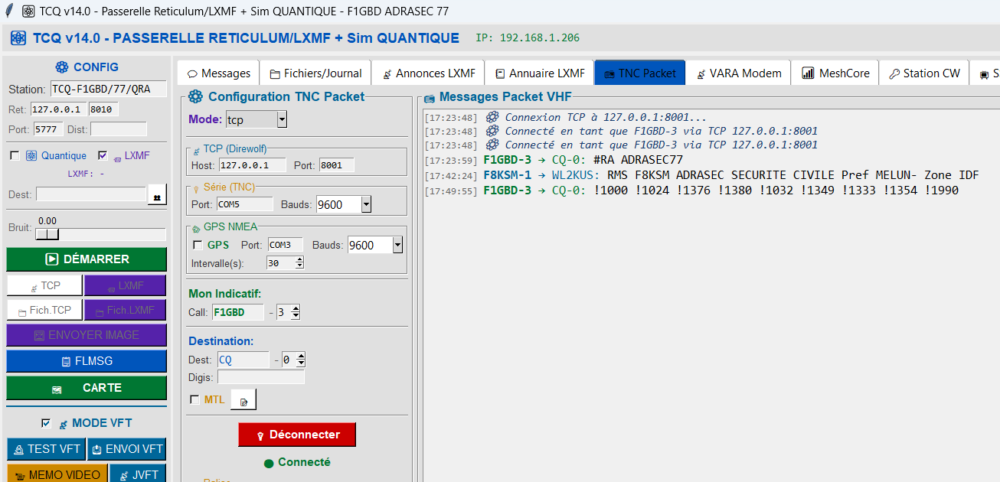
  &nbsp;&nbsp;
  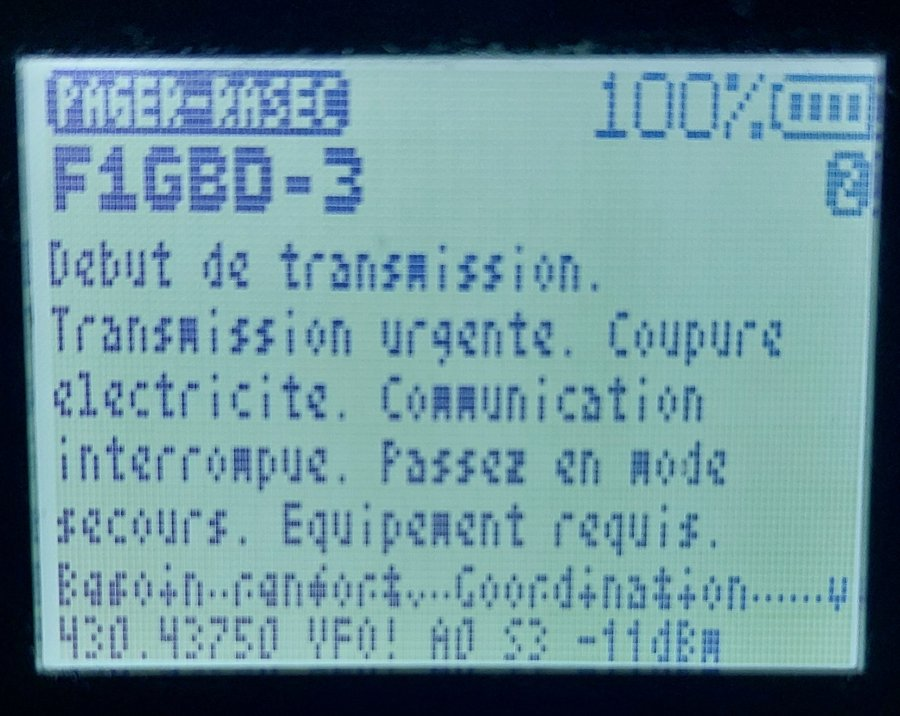
</p>
<p align="center"><em>Message CHAPPE26 de 9 codes envoyé par TCQ et décodé sur le UV-K1 (en v1.2.1).</em></p>

## CHAPPE-TX : émettre un message CHAPPE26 depuis le UV-K1

Avec **CHAPPE-TX**, l'opérateur de terrain compose le message au clavier (la radio
affiche la phrase en clair de chaque code), le relit, puis l'émet par **PTT** en une
trame AX.25 `F1GBD-7>CQ`. TCQ (**v14.1 ou plus récent**, onglet TNC Packet) et PAGER-RASEC
le traduisent automatiquement.

<p align="center">
  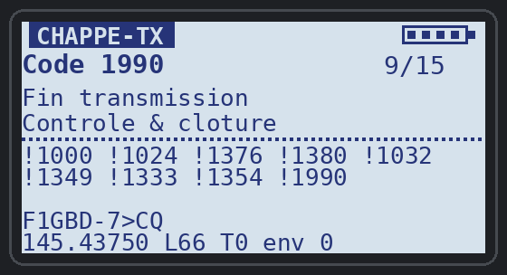
  &nbsp;&nbsp;
  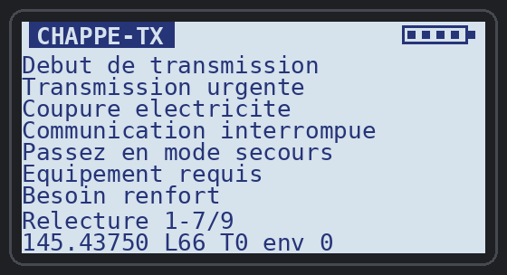
</p>
<p align="center"><em>Message de 9 codes prêt à partir, puis relecture en clair (F puis MENU) — maquettes d'écran</em></p>

**Indicatif** (nouveau en v1.1) : il se saisit sur la radio, sans PC — **F puis 0**, lettres
avec **< / >**, chiffres au clavier, **\*** pour passer au caractère suivant, **MENU** pour
valider (le SSID se règle à part, F 3 / F 9). Au premier lancement l'éditeur s'ouvre seul.

Saisie : taper les 4 chiffres du code puis **MENU** pour l'ajouter ; **< / >** parcourt le
répertoire, **\*** retire le dernier code, **F MENU** relit, **PTT** émet. Le code 1000 est
déjà affiché au lancement.

| Exemple | Touches | Trame émise | Reçu en clair | Durée |
|---|---|---|---|---|
| Test de liaison | `1000 MENU 1016 MENU 1990 MENU PTT` | `!1000 !1016 !1990` | Debut de transmission. Test de liaison. Fin transmission. | 0,55 s |
| Demande d'ambulance | `1204 MENU PTT` | `!1204` | Ambulance requise. | 0,47 s |
| Black-out | `1000 MENU 1024 MENU 1376 MENU 1380 MENU 1032 MENU 1349 MENU 1333 MENU 1354 MENU 1990 MENU PTT` | `!1000 !1024 !1376 !1380 !1032 !1349 !1333 !1354 !1990` | Debut de transmission. Transmission urgente. Coupure electricite. Communication interrompue. Passez en mode secours. Equipement requis. Besoin renfort. Coordination requise. Fin transmission. | 0,79 s |
| Incendie majeur | `1000 MENU 1024 MENU 1303 MENU 1302 MENU 1314 MENU 1329 MENU 1204 MENU 1333 MENU 1990 MENU PTT` | `!1000 !1024 !1303 !1302 !1314 !1329 !1204 !1333 !1990` | Debut de transmission. Transmission urgente. Incendie signale. Incident majeur. Evacuation requise. Victimes signalees. Ambulance requise. Besoin renfort. Fin transmission. | 0,79 s |
| Inondation | `1000 MENU 1024 MENU 1308 MENU 1314 MENU 1366 MENU 1392 MENU 1369 MENU 1990 MENU PTT` | `!1000 !1024 !1308 !1314 !1366 !1392 !1369 !1990` | Debut de transmission. Transmission urgente. Inondation. Evacuation requise. Refuge ouvert. Hebergement requis. Ravitaillement requis. Fin transmission. | 0,75 s |
| Accusé d'un ordre | `1001 MENU 1002 MENU 1326 MENU 1103 MENU 1990 MENU PTT` | `!1001 !1002 !1326 !1103 !1990` | Message recu. Message compris. Equipe secours en route. Dans 10 minutes. Fin transmission. | 0,63 s |
| Fin d'intervention | `1000 MENU 1316 MENU 1352 MENU 1328 MENU 1397 MENU 1990 MENU PTT` | `!1000 !1316 !1352 !1328 !1397 !1990` | Debut de transmission. Evacuation terminee. Situation sous controle. Intervention terminee. Fin operation. Fin transmission. | 0,67 s |

Trames décodées (FCS correcte) et durées mesurées sur l'application réelle en émulation ;
premier essai sur l'air le 9 octobre 2026 : trame reçue par TCQ. Détails : [notice](apps/CHAPPE-TX.md) et
[manuel CHAPPE-TX](documentation/CHAPPE-TX_Manuel_v1.1.pdf).

## RGRAM : rédiger et émettre un RADIOGRAMME depuis le UV-K1

Avec **RGRAM**, l'opérateur de terrain rédige un **radiogramme ADRASEC** au clavier
— indicatif, origine, date et heure, niveau d'alerte, 8 lignes de description — avec
une saisie **multi-tap comme sur un téléphone** (2 = ABC, 3 = DEF…), puis l'émet par
**PTT** en AX.25 Packet, au format exact de la fenêtre « RADIOGRAMME ADRASEC — Packet VHF »
de TCQ (zlib + base64, trames `{QR:…}`). TCQ le reconstitue, **valide son CRC** et
l'enregistre comme un radiogramme TCQ ; un autre UV-K1 sous **PAGER-RASEC v1.4.1**
l'affiche comme un message reçu (« ADRASEC 77 14:32 PRIORITE: INCENDIE ENTREPOT ZONE NORD / … »).

<p align="center">
  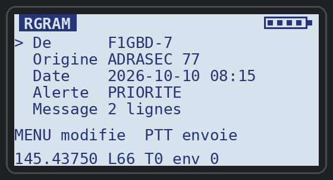
  &nbsp;&nbsp;
  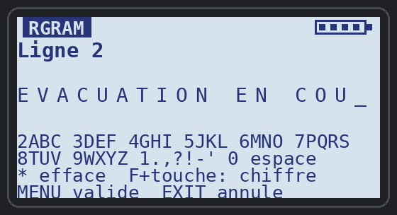
</p>
<p align="center"><em>Formulaire du radiogramme et saisie d'une ligne (maquettes d'écran)</em></p>

Détails : [notice RGRAM](apps/RGRAM.md) et [manuel RGRAM](documentation/RGRAM_Manuel_v1.1.pdf)
(4 exemples de radiogrammes). Validé en émulation avec les fonctions de
réception de TCQ ; essai sur l'air à venir.

Depuis **TCQ v14.2**, la case **📟 Compatible pager UV-K1** de la fenêtre radiogramme
Packet envoie aussi les radiogrammes du PC de crise dans ce format : ils s'affichent
sur les pagers de terrain.

## TACVYR : messages tactiques courts, sans phonie

Avec **TACVYR**, l'opérateur échange des **messages tactiques courts sans parler** — en
salle de COD, en approche discrète, en zone bruyante. Un **code à 2 chiffres** choisit
une phrase parmi 81 (1re touche : la rubrique s'affiche, 2e touche : la phrase) ; un
message joint **1 ou 2 phrases**, ou un **texte libre** court saisi en multi-tap. **PTT**
l'émet en AX.25 Packet, en clair, vers `CQ` : TCQ, PAGER-RASEC et un autre UV-K1 sous
TACVYR l'affichent. Entre deux saisies, la radio écoute le VFO et garde les 6 derniers
messages.

<p align="center">
  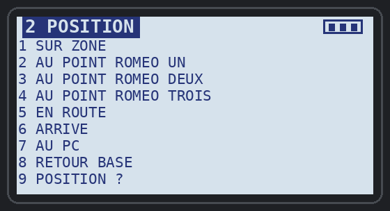
  &nbsp;&nbsp;
  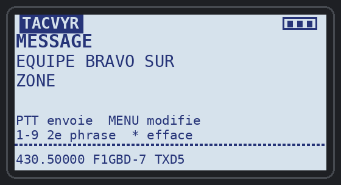
</p>
<p align="center"><em>Touche 2 : la rubrique POSITION ; 1 2 puis 2 1 : « EQUIPE BRAVO SUR ZONE » (maquettes d'écran)</em></p>

| Touches | Message émis | Durée |
|---|---|---|
| `1 2  2 1  PTT` | EQUIPE BRAVO SUR ZONE | 0,81 s |
| `7 1  PTT` | RECU | 0,69 s |
| `3 5  2 2  PTT` | DEMANDE POUR ACTION AU POINT ROMEO UN | 0,91 s |
| `5 1  2 3  PTT` | BALISE TROUVEE AU POINT ROMEO DEUX | 0,89 s |

Liste complète des codes, touches et réglages (TXDELAY 300 / 500 / 800 ms pour
passer par un relais) : [notice TACVYR](apps/TACVYR.md), [manuel PDF](documentation/TACVYR_Manuel_v1.0.pdf)
et [carte opérateur à imprimer](documentation/TACVYR_Carte_Operateur.pdf).

<p align="center">
  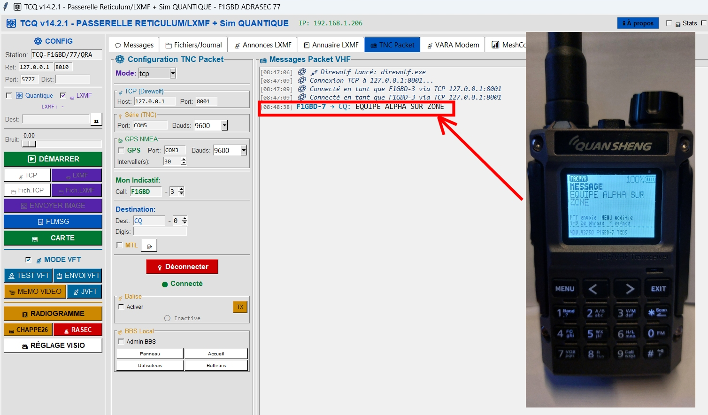
</p>
<p align="center"><em>Essai sur l'air réussi le 11 octobre 2026 : « EQUIPE ALPHA SUR ZONE » composé sur le UV-K1 (F1GBD-7) et reçu en clair par TCQ v14.2.1 (onglet TNC Packet)</em></p>

## EPIRBdecoder : balises 406 MHz décodées et relayées en Packet

Avec **EPIRBdecoder**, le UV-K1 de l'équipe de recherche **reçoit les balises de détresse
406 MHz** (EPIRB, ELT, PLB, balises d'exercice) et les **affiche comme l'application Android
EPIRB decoder** : ID 15 hex, pays, protocole, MMSI, position en degrés décimaux et en DMS,
BCH (2 bits corrigés par bloc), 121,5 MHz, source de position, en police normale ; les
5 dernières balises restent en mémoire. **PTT** — ou le mode **AUTO** — **relaie la position de la balise en
AX.25 Packet** (position APRS) **sur une autre fréquence** : TCQ la place sur sa carte.

**Nouveau en v1.1 — mode DATA (touche 3)** : sans émettre, le pocket envoie chaque balise reçue
à une **tablette ou un téléphone Android** branché en **OTG** (câble de programmation, ou audio de
la sortie écouteur) ; **[EPIRBdecoder Android v0.4.0](https://github.com/f1gbd/F1GBD/blob/HEAD/epirb/android/README.md)** (sources
« UV-Kx USB » / « UV-Kx audio ») refait le décodage complet et affiche la position en **MGRS**,
la carte et l'itinéraire jusqu'à la balise.

<p align="center">
  
  &nbsp;
  
</p>
<p align="center"><em>Essai réel du 11 octobre 2026 : balise d'entraînement (générateur EPIRB OC + HackRF, 434,000 MHz) décodée par le UV-K1 sous
EPIRBdecoder v1.1 en mode DATA, transmise par le câble de programmation en OTG à la tablette sous EPIRBdecoder Android v0.4.0
(source UV-Kx USB) : 1C7E12D23F81FE0, France (227), National Loc. (Test), 48.5544° N 2.6311° E, MGRS 31U DP 72777 77988,
BCH OK, 121,5 MHz ; à droite, la position ouverte dans Google Maps par le bouton Carte</em></p>


<p align="center">
  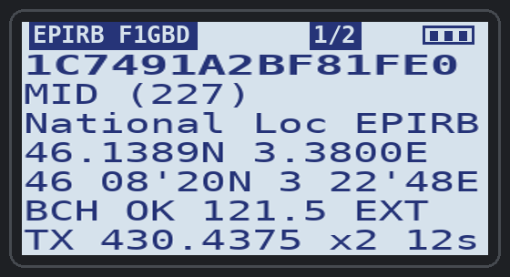
  &nbsp;&nbsp;
  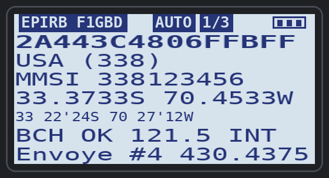
</p>
<p align="center"><em>Balise National Location reçue 2 fois ; EPIRB-MMSI relayée sur 430,4375 MHz en mode AUTO (maquettes d'écran)</em></p>

Réglage : le **VFO** sur la fréquence Packet radioamateur de l'exercice (**430,4375 MHz** par exemple,
FM large, CTCSS du transpondeur si besoin) ; la **réception** se choisit dans l'App (touche **2**) :
canaux **406,025 à 406,040 MHz** ou **434,000 MHz** pour une balise d'entraînement. L'application
**refuse d'émettre entre 405 et 407 MHz**. L'indicatif se saisit sur la radio (touche **F**).
Trame reçue par TCQ (v1.1 : pays en code MID, message 406 complet en fin de ligne pour la tablette) :

```
F1GBD-7>CQ: !4608.33N\00322.80E!EPIRB 1C7491A2BF81FE0 MID (227) National Loc EPIRB 121.5 406:N8E3A48D14B8803609C03B58A4C0261
```

Détails, touches et différences avec l'application Android : [notice EPIRBdecoder](apps/EPIRBdecoder.md) et
[manuel technique PDF](documentation/EPIRBdecoder_Manuel_v1.1.pdf).
Validé en émulation (23 essais, comparés au décodeur PC et à l'application Android), puis **sur l'air** :

<p align="center">
  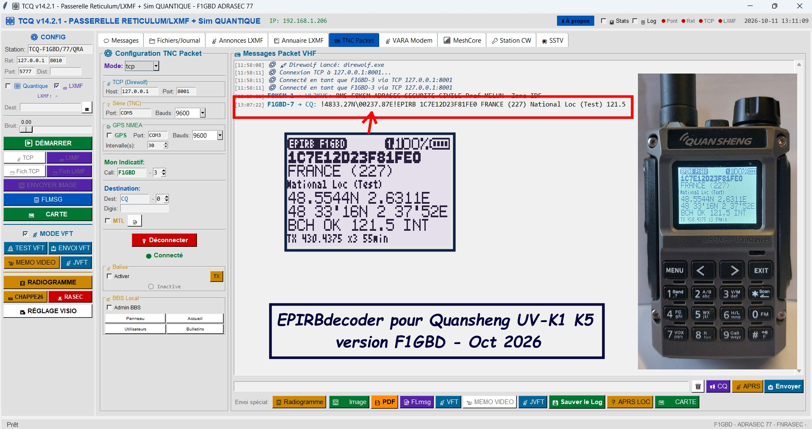
</p>
<p align="center"><em>Essai réel du 11 octobre 2026 : balise d'entraînement (générateur EPIRB OC + HackRF sur 434,000 MHz) décodée
par le UV-K1 sous EPIRBdecoder (1C7E12D23F81FE0, National Loc (Test), 48.5544N 2.6311E, BCH OK, 121,5 MHz),
puis relayée par PTT sur 430,4375 MHz : TCQ v14.2.1 la reçoit (F1GBD-7 → CQ, position APRS 4833.27N 00237.87E)</em></p>

<p align="center">
  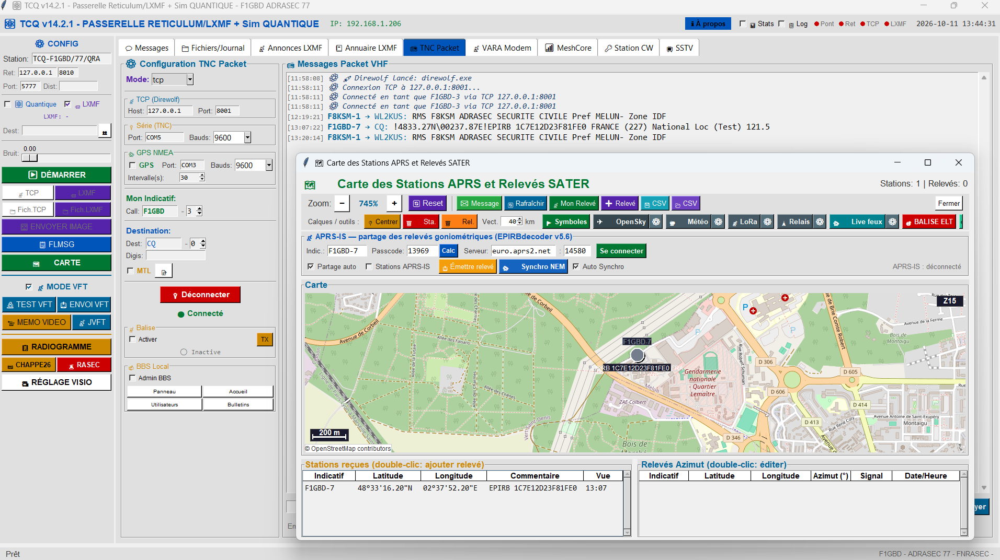
</p>
<p align="center"><em>La position de la balise EPIRB décodée par l'App EPIRBdecoder v1.0.1 reçue par le Quansheng UV K1/K5 est renvoyée en AX25 Packet par le pocket sur une fréquence ADRASEC en RADIO PURE PACKET (ici le transpondeur F5ZYI), elle est reçue et affichée sur la Cartographie TCQ en mode Packet</em></p>

## KISS-TNC : le UV-K1 comme TNC Packet pour TCQ

Avec **KISS-TNC**, le portatif devient un **TNC Packet AX.25 1200 bauds** piloté en
**KISS** par le simple **câble de programmation** (prise K, 38400 bauds) : le PC de crise
sous **[TCQ v14.3](https://github.com/f1gbd/F1GBD/tree/master/tcq)** (onglet TNC Packet,
mode série) envoie ses **radiogrammes, messages et images** par la radio et reçoit
toutes les trames AX.25 de la fréquence — **sans TNC matériel, sans Direwolf, sans carte
son**. L'App applique le TXDELAY de TCQ (800 ms pour passer par les transpondeurs),
attend que le canal soit libre (CSMA), groupe les trames en attente sous une même
émission, et garde le CTCSS / DCS et la puissance du VFO ; jamais d'émission entre 405
et 407 MHz.

<p align="center">
  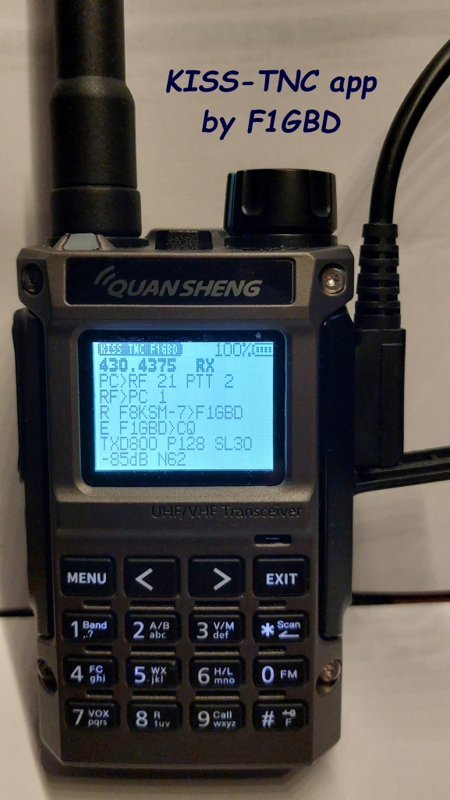
  &nbsp;&nbsp;
  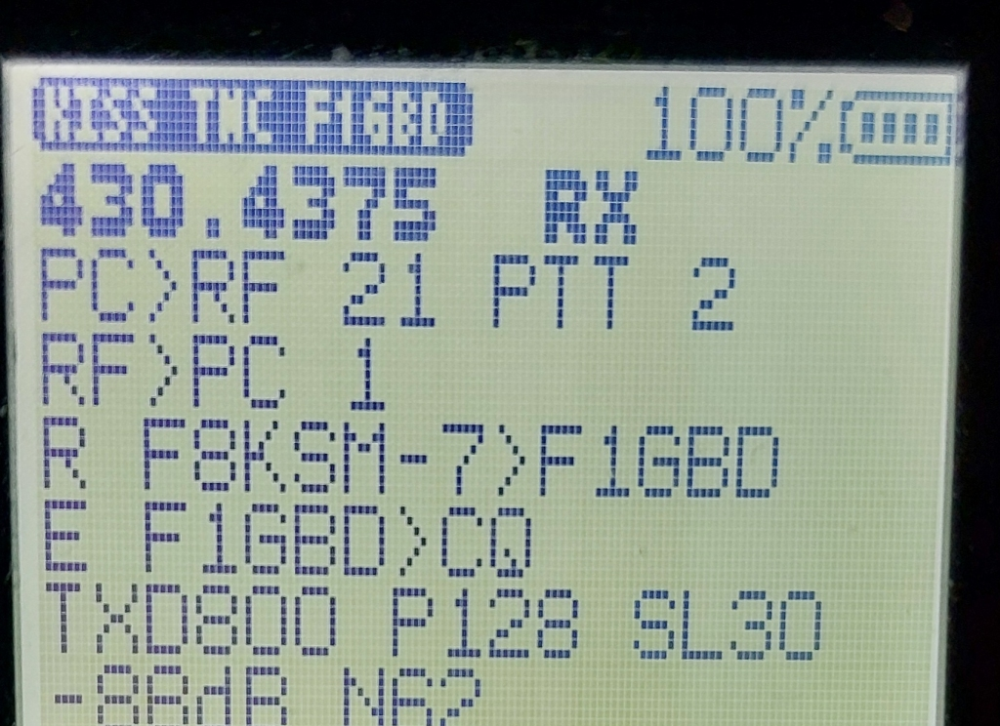
</p>
<p align="center"><em>Le UV-K1 sous KISS-TNC sur la prise K ; l'écran après l'envoi d'une image de 21 trames par TCQ v14.3
(2 passages en émission, TXD800 P128 SL30, accusé de F8KSM-7 reçu)</em></p>

<p align="center">
  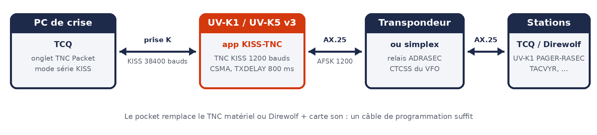
</p>

<p align="center">
  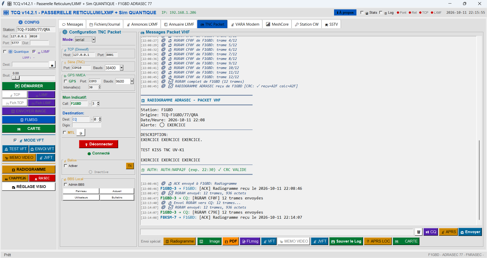
  &nbsp;
  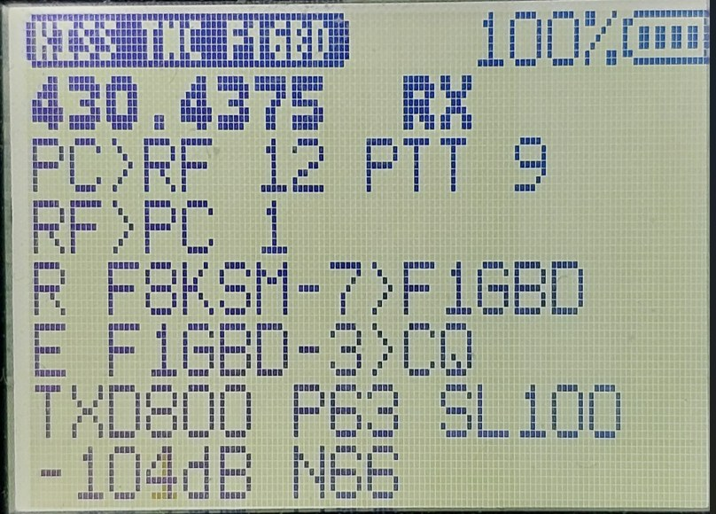
</p>
<p align="center"><em>Essai sur l'air du 11 octobre 2026 : TCQ (série COM10, 38400 bauds) → UV-K1 sous KISS-TNC sur 430,4375 MHz →
transpondeur → F8KSM-7. Radiogramme ADRASEC de 12 trames (CRC valide) puis image de 21 trames reçus complets,
accusés de réception reçus par radio ; dans l'autre sens, image de 16 trames enchaînées par Direwolf reçue 16 / 16. À droite : 12 trames émises en 9 passages, l'accusé de F8KSM-7 reçu.</em></p>

Réglages TCQ : mode **serial**, port COM du câble, **38400** bauds, TX Delay 800 ms,
Persistence 128, Slot Time 30 ms, Max Packet Len 255. Lancer KISS-TNC **avant** de
cliquer sur Connecter. **TCQ v14.3** est nécessaire pour les images : en mode série, il
envoie au rythme où la radio peut émettre (la radio garde 1,2 Ko en attente). EXIT rend
la prise K au firmware (CHIRP, UV Studio). Détails : [notice KISS-TNC](apps/KISS-TNC.md) et
[manuel PDF](documentation/KISS-TNC_Manuel_v0.1.pdf).

## WinKISS-TNC : Winlink Express en Packet avec le UV-K1

KISS-TNC fonctionne aussi avec **Winlink Express** en mode **Packet Winlink / P2P**, grâce à
**[WinKISS-TNC](https://github.com/f1gbd/F1GBD/tree/master/winkiss-tnc)**, une passerelle Windows qui
remplace SoundModem ou Direwolf : Winlink Express parle KISS sur TCP (`127.0.0.1:8100`) et WinKISS-TNC
relaie les trames vers le UV-K1 par le câble de programmation (38400 bauds). Il gère le **KISS ACKMODE**
de Winlink (accusé rendu à la fin estimée de l'émission) et donne les trames à la radio **au rythme où
elle peut les émettre** : les trames de 255 octets de Winlink passent sans débordement.

<p align="center">
  
</p>
<p align="center"><em>Essai réel du 12 octobre 2026 : Winlink Express (F1GBD-1) → WinKISS-TNC v1.0 → câble DATA sur COM10
à 38400 bauds → UV-K1 sous KISS-TNC en UHF → RMS Packet F8KSM-1 (ADRASEC — Zone IDF). Connexion, échange B2F et
lecture des messages Winlink en attente ; à droite, le moniteur de WinKISS-TNC (trames I du RMS, accusés RR).</em></p>

Dans Winlink Express : session **Packet Winlink**, Settings → Packet TNC Type **KISS**, Packet TNC Model
**ACKMODE**, Serial Port **TCP**, `localhost` port `8100`, Packet sound modem = `WinKISS-TNC.exe` avec
« Automatically launch packet sound modem » coché ; TX Delay 800, Max Packet Length 255, Max Frames 4,
Persistence 128, Slot time 30. Lancer KISS-TNC sur la radio **avant** d'ouvrir la session.
Installation et réglages : [page WinKISS-TNC](https://github.com/f1gbd/F1GBD/tree/master/winkiss-tnc) et
son [manuel PDF](https://github.com/f1gbd/F1GBD/blob/master/winkiss-tnc/documentation/WinKISS-TNC_Manuel_v1.0.pdf).

## Documentation

| Document | Formats |
|---|---|
| PAGER-RASEC v1.4.1 — Manuel d'installation et d'utilisation | [PDF](documentation/PAGER-RASEC_Manuel_v1.4.pdf) |
| CHAPPE-TX v1.1 — Manuel d'utilisation et exemples de transmission | [PDF](documentation/CHAPPE-TX_Manuel_v1.1.pdf) |
| RGRAM v1.1 — Manuel d'utilisation et exemples de radiogrammes | [PDF](documentation/RGRAM_Manuel_v1.1.pdf) |
| TACVYR v1.0 — Manuel d'utilisation, codes et exemples d'échanges | [PDF](documentation/TACVYR_Manuel_v1.0.pdf) |
| TACVYR — Carte opérateur A4 (les 81 codes et les touches, à plastifier) | [PDF](documentation/TACVYR_Carte_Operateur.pdf) |
| EPIRBdecoder v1.1 — Manuel technique et d'utilisation : réglages, écrans, relais AX.25 / TCQ, mode DATA vers EPIRBdecoder Android, signal 406 MHz et décodage, procédure SATER, dépannage | [PDF](documentation/EPIRBdecoder_Manuel_v1.1.pdf) |
| KISS-TNC v0.1 — Manuel d'installation et d'utilisation : raccordement à TCQ, écran, fonctionnement (KISS, CSMA, TXDELAY), essai sur l'air, dépannage | [PDF](documentation/KISS-TNC_Manuel_v0.1.pdf) |
| Code CHAPPE26 — Livret de poche B5 (18 pages) : répertoire des 1000 codes, carte opérateur, chiffrement | [PDF](documentation/Chappe26_Livret_B5.pdf) |
| Code CHAPPE26 — Fiche exemple Black-out : demande de moyens radio de secours | [PDF](documentation/Chappe26_Fiche_BlackOut.pdf) |
| Code CHAPPE26 — Fiche exemple Incendie majeur : renforts, évacuation, radio en zone blanche | [PDF](documentation/Chappe26_Fiche_Incendie.pdf) |

## Applications

| Application | Version | Rôle |
|---|---|---|
| [PAGER-RASEC](apps/PAGER-RASEC.md) ([manuel PDF](documentation/PAGER-RASEC_Manuel_v1.4.pdf)) | 1.4.1 | Pager RASEC-ALERT : réception AX.25 Packet 1200 bauds depuis TCQ, lampe blanche frontale + sirène sur `#ra <code>`, messages CHAPPE26 en clair, radiogrammes RGRAM et TCQ v14.2 affichés, historique de 6 messages, 145.4375 MHz FM |
| [CHAPPE-TX](apps/CHAPPE-TX.md) ([manuel PDF](documentation/CHAPPE-TX_Manuel_v1.1.pdf)) | 1.1 | Émetteur CHAPPE26 : message composé au clavier (phrases en clair, relecture), émis en AX.25 Packet 1200 bauds vers CQ comme TCQ — reçu en clair par TCQ et PAGER-RASEC |
| [RGRAM](apps/RGRAM.md) ([manuel PDF](documentation/RGRAM_Manuel_v1.1.pdf)) | 1.1 | Émetteur de radiogrammes ADRASEC : formulaire et saisie multi-tap sur la radio, émission AX.25 Packet au format TCQ (`{QR:…}`, CRC validé par TCQ), lu par PAGER-RASEC v1.4 |
| [TACVYR](apps/TACVYR.md) ([manuel PDF](documentation/TACVYR_Manuel_v1.0.pdf)) | 1.0 | Messages tactiques courts sans phonie : code à 2 chiffres (81 phrases), 1 ou 2 phrases ou texte libre, émis et reçus en AX.25 Packet 1200 bauds sur le VFO, en clair pour TCQ et PAGER-RASEC |
| [EPIRBdecoder](apps/EPIRBdecoder.md) ([manuel PDF](documentation/EPIRBdecoder_Manuel_v1.1.pdf)) | 1.1 | Balises 406 MHz : réception et décodage comme l'application Android (ID, code pays MID, protocole, MMSI, position décimale et DMS, BCH corrigé, 121,5), 5 balises gardées, réception 406,025-406,040 ou 434,000 MHz (entraînement) au choix, relais de la position en AX.25 Packet (APRS, compatible TCQ) sur la fréquence radioamateur du VFO, par PTT ou AUTO ; **mode DATA** vers EPIRBdecoder Android (OTG : câble de programmation ou audio, MGRS sur la tablette) — récepteur EPIRB 406 de F4WAT |
| [KISS-TNC](apps/KISS-TNC.md) ([manuel PDF](documentation/KISS-TNC_Manuel_v0.1.pdf)) | 0.1 | TNC KISS AX.25 1200 bauds sur la prise K (câble de programmation, 38400 bauds) pour TCQ v14.3 (TNC Packet, mode série) et Winlink Express (Packet Winlink / P2P, via [WinKISS-TNC](https://github.com/f1gbd/F1GBD/tree/master/winkiss-tnc)) : radiogrammes, messages et images par la radio, sans Direwolf ; TXDELAY 800 ms pour les transpondeurs, CSMA, CTCSS du VFO conservé, jamais entre 405 et 407 MHz |
| CHAPPE26 | 1.0 | Dictionnaire CHAPPE26 (1000 codes) pour PAGER-RASEC et CHAPPE-TX — à installer avec eux |

## Ajouter une application

1. Construire le `.app` (`./compile-app.sh <app>` dans l'arborescence firmware).
2. Copier le `.app` et sa notice dans `apps/`.
3. Ajouter une entrée dans `apps/manifest.json` (`file`, `name`, `version`, `title`, `summary`, `doc`).

ADRASEC 77 · F1GBD — 73
