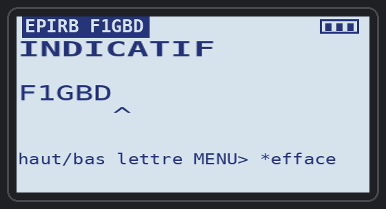
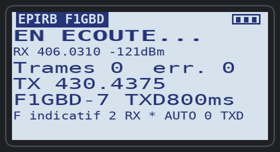

# EPIRBdecoder v1.0.1 — balises 406 MHz décodées et relayées en Packet pour Quansheng UV-K1 / UV-K5 v3

Application overlay (`.app`) pour le firmware F4HWN édition Labs. Elle **reçoit les
balises de détresse Cospas-Sarsat 406 MHz** (première génération : EPIRB, ELT, PLB,
balises d'exercice), les **décode comme l'application Android EPIRB decoder** et
peut **relayer la position de la balise en AX.25 Packet 1200 bauds** (position APRS,
compatible TCQ) **sur une autre fréquence** : l'équipe de recherche sur le terrain
transmet au PC de crise ce qu'elle reçoit, sans phonie et sans recopie.

<p align="center">
  
  &nbsp;
  
</p>
<p align="center"><em>À gauche : une balise National Location (France), reçue 2 fois. À droite : une EPIRB-MMSI,
relayée sur 430,4375 MHz en mode AUTO (maquettes d'écran, textes de l'application réelle en émulation)</em></p>

| | |
|---|---|
| Réception | **choisie dans l'App** (touche 2) : 406,025 · 406,028 · **406,031** · 406,037 · 406,040 MHz, ou **434,000 MHz** (balise d'entraînement / de test) ; récepteur **RAW** et décodeur dec406 de l'application **EPIRB 406** de Johan **F4WAT** : déclenchement sur le RSSI, échantillonnage à 9,6 kHz |
| Décodage | comme le décodeur PC / Android (EPIRB-decoder v5.22) : ID 15 hex, pays, protocole, MMSI, position décimale et DMS, BCH (**2 bits corrigés** par bloc), 121,5 MHz, source de position |
| Mémoire | les **5 dernières balises**, regroupées par ID (nombre de réceptions, âge) |
| Relais | **PTT** (balise affichée) ou **AUTO** (chaque nouvelle trame valide, au plus une fois par balise toutes les 30 s) : une trame UI `<indicatif>-<SSID>` → `CQ`, position APRS `!DDMM.mmN\DDDMM.mmE!EPIRB …` |
| Fréquence d'émission | celle du **VFO** : une fréquence radioamateur (430,4375 MHz par exemple), avec son CTCSS si un transpondeur le demande ; **jamais entre 405 et 407 MHz** |
| Émission | 1,0 à 1,6 s selon le TXDELAY (300, 500 ou 800 ms) |
| Écran | police normale (18 caractères par ligne), « EPIRB F1GBD » en haut de l'écran |
| Taille | 4 076 o de code (overlay 4 Kio) + 3 806 o de ressources (dont 2 modules) |

Manuel technique complet : [PDF](../documentation/EPIRBdecoder_Manuel_v1.0.1.pdf).

<p align="center">
  
</p>
<p align="center"><em>Essai réel du 11 octobre 2026 : balise d'entraînement (générateur EPIRB OC + HackRF, 434,000 MHz) décodée
par le UV-K1 et relayée sur 430,4375 MHz, reçue par TCQ v14.2.1 : <code>F1GBD-7 → CQ: !4833.27N\00237.87E!EPIRB 1C7E12D23F81FE0 FRANCE (227) National Loc (Test) 121.5</code></em></p>

## Installation

1. Ouvrir l'**[UV-K1 Apps Uploader](../index.html)** dans Chrome ou Edge.
2. Brancher la radio (USB-C), **Connecter la radio**, choisir le port série.
3. Sélectionner **Décodeur de balises EPIRBdecoder**, garder l'emplacement proposé, **Installer**.

## Préparer la radio

| | Réglage |
|---|---|
| **VFO** | la **fréquence AX.25** de l'exercice, une fréquence radioamateur : **430,4375 MHz** par exemple, simplex, FM **large (W)**, avec le **CTCSS** du transpondeur s'il en demande un (77,0 Hz…) ; la puissance d'émission est celle du VFO |
| **Réception** | se choisit **dans l'App** avec la touche **2** (gardée à la sortie) : 406,025 · 406,028 · **406,031** (par défaut, couvre 406,025 à 406,040) · 406,037 · 406,040 · **434,000 MHz** (balise d'entraînement / de test) |

L'App écoute la fréquence choisie et n'émet que sur celle du VFO : au PTT la radio passe
sur le VFO, émet la trame, puis revient sur la fréquence de réception.

**Sécurité** : si le VFO est entre **405 et 407 MHz** (VFO laissé sur 406 par erreur),
l'application **refuse d'émettre** (« TX 406 interdit ») : on n'émet jamais dans la bande
des balises. Les verrous d'émission du firmware s'appliquent aussi (« TX refuse »).

**CTCSS / DCS** : le sous-ton programmé sur le VFO est **émis avec la trame** (il n'est pas
coupé), pour ouvrir un transpondeur ; il ne gêne ni le Packet 1200 bauds ni la réception
de la balise (l'App écoute le son brut, sans squelch).

Puis menu **Apps** → **EPIRBdecoder**. L'écran d'attente rappelle la fréquence de
réception (« RX 406.0310 »), la fréquence d'émission (« TX 430.4375 ») et l'indicatif
(« F1GBD-7 TXD800ms »).

## L'indicatif (touche F)

<p align="center"></p>

Sans indicatif, le PTT est refusé (« Indicatif ? »). **F** ouvre la saisie :

| Touche | Action |
|---|---|
| **▲ / ▼** | change la lettre sous le curseur ^ (A à Z) |
| **0 à 9** | tape un chiffre et passe au caractère suivant |
| **MENU** | caractère suivant |
| **\*** | efface à partir du curseur |
| **F** ou **EXIT** | termine |

Exemple pour F1GBD : ▲ jusqu'à F, **1**, ▲ jusqu'à G, MENU, ▲ jusqu'à B, MENU, ▲ jusqu'à D, **F**.
6 caractères au plus, enregistré à la sortie de l'App. Laissé vide, c'est l'indicatif du
**message d'accueil** de la radio qui sert (s'il en contient un). Le SSID se règle avec la
touche **8** (7 par défaut).

## L'écran

<p align="center"></p>

| Ligne | Contenu | Application Android |
|---|---|---|
| Barre d'état | **EPIRB F1GBD**, HP (haut-parleur), AUTO, rang de la balise « 1/3 », batterie | — |
| 1 (gras) | **ID 15 hex** (position remplacée par les valeurs par défaut C/S T.001) | hex |
| 2 | **pays (MID)**, EXER (trame d'exercice), COURT (message court) | pays |
| 3 | **protocole** (National Loc EPIRB, RLS/Std Loc (code 14)…), ou le **MMSI** complet pour une EPIRB-MMSI / Ship Security | protocole |
| 4 | position en **degrés décimaux** : `46.1389N 3.3800E` | décimal |
| 5 | position en **degrés, minutes, secondes** : `46 08'20N 3 22'48E` | DMS |
| 6 | **BCH** OK / NON (2 bits corrigés par bloc), **121.5** (radioralliement présent), source **INT**/**EXT** | BCH, homing |
| 7 | **fréquence d'émission**, réceptions « x2 » et âge « 12s », ou le résultat de la dernière action (« Envoye #4 430.4375 ») | fréquence |

Une ligne trop longue pour la police normale (pays au nom long, longitude à 3 chiffres)
s'affiche en petits caractères.

« Pas de position » : la balise n'en transmet pas (position par défaut), le protocole
n'en a pas (protocoles utilisateur), ou c'est un message court en Standard Location
(15' seulement : comme le décodeur PC, la position n'est pas donnée).

## Les touches

| Touche | Action |
|---|---|
| **▲ / ▼** | parcourent les balises (5 gardées, la plus récente en 1/n) |
| **PTT** | relaie la balise affichée en Packet |
| **F** | saisie de l'indicatif (voir plus haut) |
| **\*** | AUTO marche / arrêt : relaie chaque nouvelle trame valide (BCH OK), au plus une fois par balise toutes les 30 s |
| **2** | fréquence de réception suivante : 406,025 → 406,028 → 406,031 → 406,037 → 406,040 → 434,000 MHz |
| **1** | haut-parleur marche / arrêt (on entend la salve) |
| **0** | TXDELAY 300 / 500 / 800 ms (800 ms pour passer par un relais) |
| **8** | SSID 0 à 15 (7 par défaut) |
| **MENU** | efface la liste et les compteurs |
| **EXIT** | quitte (réglages enregistrés : indicatif, fréquence de réception, HP, AUTO, TXDELAY, SSID) |

## Ce que reçoit TCQ

Avec position :

```
F1GBD-7>CQ: !4608.33N\00322.80E!EPIRB 1C7491A2BF81FE0 FRANCE (227) National Loc EPIRB 121.5
F1GBD-7>CQ: !3322.40S\07027.20W!EPIRB 2A443C4806FFBFF USA (338) EPIRB-MMSI Std Loc MMSI 338123456 121.5
```

Sans position :

```
F1GBD-7>CQ: EPIRB 9C682345678ABCD FRANCE (227) Maritime User Pas de position
```

Le texte est suivi de « EXER » pour une trame d'exercice et de « BCH NON » si le message
n'a pas pu être corrigé (relais manuel seulement : AUTO ne relaie que les trames valides).
Dans l'onglet **TNC Packet**, TCQ reconnaît la position APRS et place la station sur sa
carte, avec le texte de la balise en commentaire ; PAGER-RASEC et tout TNC affichent le
texte tel quel. La position est affichée sous l'indicatif de la radio qui relaie : avec
plusieurs balises, c'est l'ID dans le commentaire qui les distingue.

## Différences avec l'application Android

- **Pas de MGRS sur la radio** : le calcul UTM (≈ 1,3 Kio, vérifié à 1 m près du décodeur
  PC) ne tient pas avec le reste dans les 7,75 Kio d'une application ; la position en
  degrés décimaux et en DMS est affichée et relayée à TCQ.
- Noms de pays en majuscules sans accent (polices de la radio) pour la France, ses voisins et
  les pavillons courants (USA, Panama, Malte, Grèce, Chypre, Maroc, Algérie…) ; les autres codes
  s'affichent « MID (338) » faute de place.
- Protocoles utilisateur nommés selon C/S T.001 (001 Aviation, 010 Maritime, 110 Radio Call
  Sign) ; le décodeur PC les nomme autrement pour les codes 1, 2 et 6.
- Pas d'heure : la radio n'a pas d'horloge, l'âge de la dernière réception est affiché.

## Essais

Application réelle exécutée instruction par instruction (Cortex-M0+, unicorn) avec des
salves synthétisées (C/N, décalage de fréquence, inversion, dérive d'horloge) et comparée
au décodeur PC : 22 essais réussis (Standard et National Location, MMSI, message court,
position par défaut, protocole utilisateur, 3 bits corrigés, exercice, BCH NON, regroupement
par ID, C/N 10 dB avec 3 kHz d'écart, relais PTT et AUTO décodés avec FCS correcte, refus
d'émettre sur 406, TXDELAY et SSID, saisie de l'indicatif, choix de la fréquence de réception, balise de la capture Android 1C7C084B48FFBFF : mêmes valeurs). Pile maximale 3 392 o.

**Essai réel du 11 octobre 2026** : générateur EPIRB OC + HackRF sur 434,000 MHz, balise National Loc (Test)
1C7E12D23F81FE0 décodée (48.5544N 2.6311E, BCH OK, 121,5 MHz, mêmes valeurs que l'application Android) et relayée
par PTT sur 430,4375 MHz : reçue par TCQ v14.2.1 et placée sur sa carte.

## Crédits

Récepteur RAW et décodeur dec406 : **EPIRBdecoder PC/Android v2.5**. Modulateur AFSK : **APRS TX** d'Armel **F4HWN** (Apache 2.0). Décodage des
champs, BCH et présentation : décodeur EPIRB PC / Android, F1GBD. EPIRBdecoder :
F1GBD / ADRASEC 77, Apache 2.0.

ADRASEC 77 · F1GBD — 73
