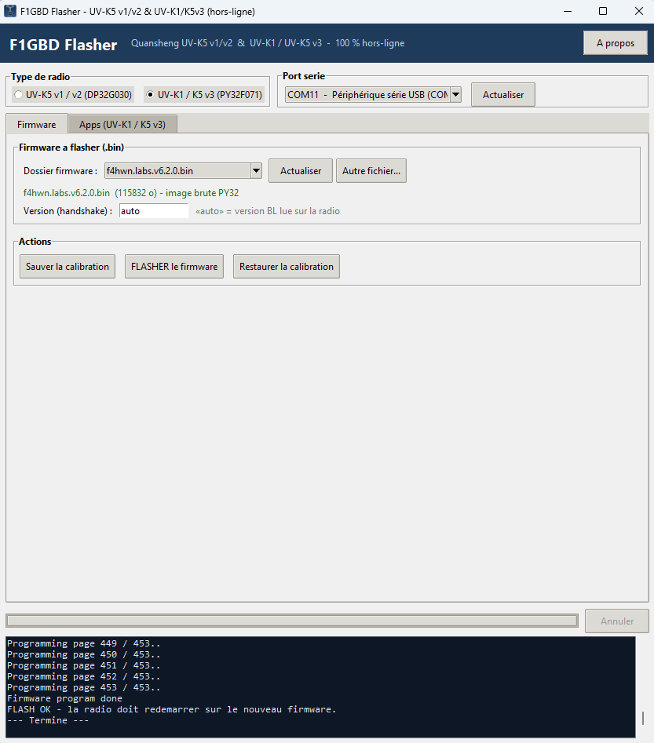
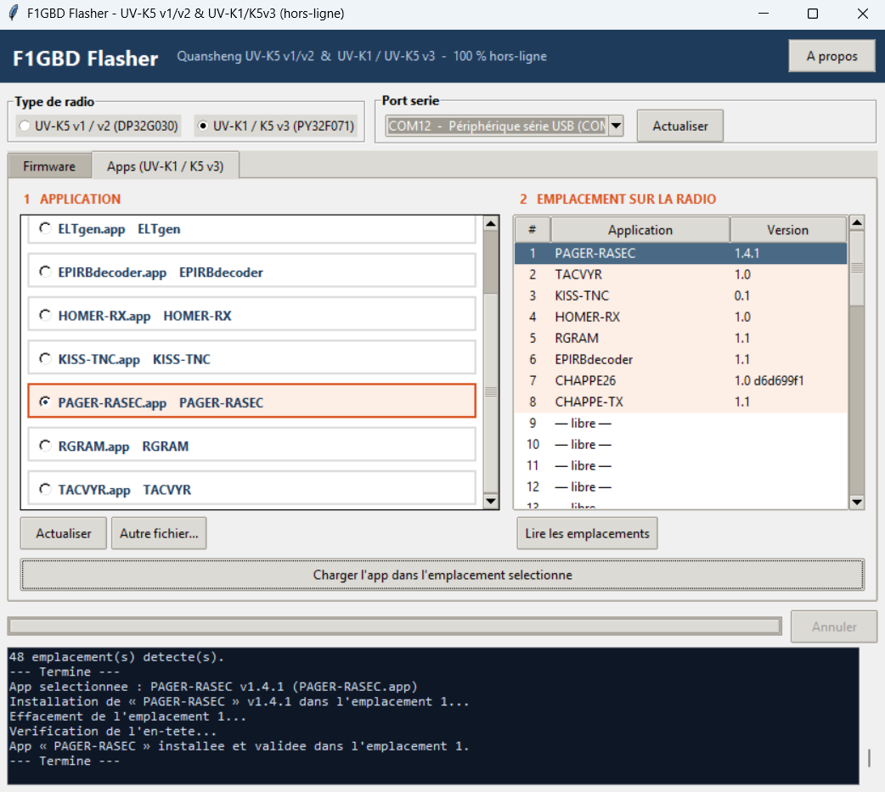

  

# F1GBD Flasher — flasheur off-grid Quansheng UV-K5 & UV-K1

Application Windows **100 % hors-ligne** (aucun serveur, aucun compte, aucun navigateur)
pour **flasher le firmware** et **charger les apps overlay** des radios Quansheng, pensée
pour les missions ADRASEC / FNRASEC où Internet n'est pas disponible.

### ▶ [Télécharger le programme d'installation](https://github.com/f1gbd/F1GBD/releases/download/flasher-v1.0/F1GBD_Flasher-1.0-setup.exe)  ·  [Manuel (PDF)](documentation/F1GBD_Flasher_Manuel_v1.0.pdf)

> [!IMPORTANT]
> Flasher comporte un risque : **sauvegardez la calibration AVANT** (bouton dédié).
> Pour l'UV-K1 / K5 v3, le *bootloader* n'est pas touché : un flash raté se rattrape
> en re-flashant.

---

## Deux familles de radio, un seul outil

| Type | Processeur | Ce que l'outil fait |
|------|------------|---------------------|
| **UV-K5 v1 / v2** | DP32G030 | firmware `.bin` brut (≤ 60 Kio), sauvegarde / restauration EEPROM |
| **UV-K1 / UV-K5 v3** | PY32F071 | firmware `f4hwn.labs` (~113 Kio), **apps overlay `.app`**, sauvegarde / restauration |

La version du bootloader du K1 est **détectée automatiquement** sur la radio (champ « auto »).

  
  &nbsp;&nbsp;
  

<em>Onglet « Firmware » (gauche) et onglet « Apps » avec le tableau des emplacements (droite)</em>

## Fonctions

- **Sauvegarde / restauration de la calibration** (EEPROM) — à faire avant tout flash.
- **Flashage du firmware** via le chargeur de démarrage, pour les deux familles.
- **Chargement des apps overlay** (`.app`) sur UV-K1 / K5 v3 : liste cliquable à gauche,
  tableau des 48 emplacements de la radio à droite (lecture + sélection par clic).
- **Détection automatique** du port série, des firmwares (dossier `firmware\`) et des
  apps (dossier `apps\`).
- **À propos → Vérifier la mise à jour** : contrôle la dernière version publiée sur GitHub.
- **100 % hors-ligne** : rien ne sort du PC (hors la vérification de mise à jour, facultative).

## Utilisation

**Onglet Firmware**
1. Choisir le **type de radio** et le **port série**.
2. **Sauver la calibration** (radio allumée normalement). *À faire d'abord.*
3. **Flasher** : radio en mode chargement / DFU (**PTT enfoncé à l'allumage**, LED allumée),
   choisir le firmware, cliquer **FLASHER**.
4. **Restaurer** la calibration si besoin.

**Onglet Apps (UV-K1 / K5 v3, radio allumée normalement)**
1. Cliquer l'**application** à gauche.
2. **Lire les emplacements** pour voir les apps déjà installées.
3. Cliquer un **emplacement** dans le tableau, puis **Charger l'app**.

Les `.bin` se déposent dans `firmware\`, les `.app` dans `apps\` — ils apparaissent
alors dans les listes, sans réinstaller.

## Installation

Lancez `F1GBD_Flasher-1.0-setup.exe` : installation dans `C:\F1GBD_Flasher`
(dossier inscriptible), raccourcis Bureau / menu Démarrer. Vos firmwares et apps
ajoutés sont conservés lors des mises à jour et à la désinstallation.

## Sécurité & licence

- Testé sur l'air : flash **UV-K5 v1** ✅, flash **UV-K1** ✅, chargement d'apps ✅ (17 octobre 2026).
- Pilote PY32 (UV-K1/K5v3) : modules de **muzkr** — licence MIT.
- Apps overlay : protocole du firmware **F4HWN** (édition Labs) — mêmes commandes qu'UV Studio.
- Application distribuée sous **licence GNU GPL v3**.

*F1GBD (Jean-Louis Naudin) — ADRASEC 77 / FNRASEC*
