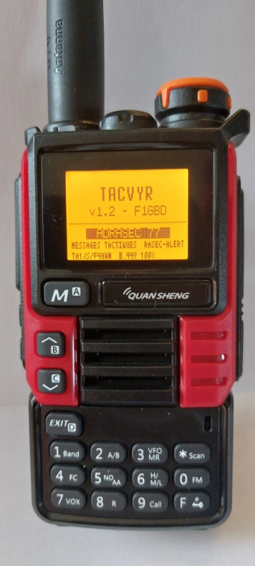
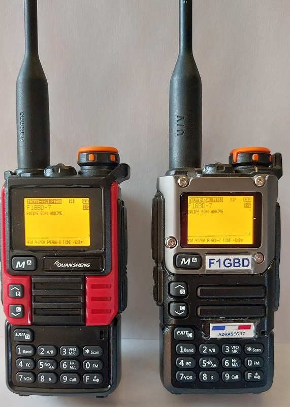
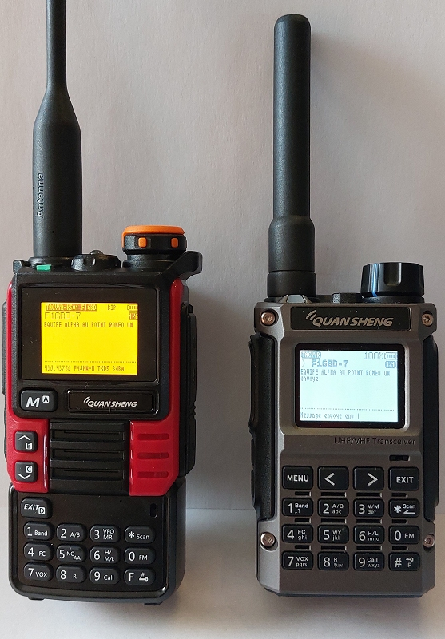

# TACVYR K5 v1.3 — messages tactiques AX.25, RASEC-ALERT et TNC KISS pour Quansheng UV-K5 / K6 / 5R « v1 »



Firmware complet pour les **UV-K5 / K6 / 5R « v1 »** (processeur DP32G030, puce radio
BK4819) : le firmware **TA1JS v1.3** (lignée F4HWN / egzumer) dans lequel la suite APRS
est remplacée par **TACVYR**, l'application de messages tactiques courts du UV-K1,
complétée par les **alertes RASEC-ALERT** de TCQ, comme le pager **PAGER-RASEC**.

Mêmes 81 phrases, mêmes touches, même trame AX.25 que **TACVYR UV-K1** : un UV-K5 v1
et un UV-K1 se parlent, et **TCQ**, **PAGER-RASEC** ou tout TNC lisent les messages en clair.
Le parc de UV-K5 v1 des ADRASEC peut ainsi servir là où la phonie est impossible
(COD, approche discrète, zone bruyante).

**Nouveau en v1.3 : mode TNC KISS** (F puis BAS dans TACVYR). Relié au PC par le câble de
programmation, le UV-K5 v1 devient un TNC Packet 1200 bauds comme l'application
**KISS-TNC** du UV-K1 : **TCQ** (messages, radiogrammes, images, RASEC-ALERT) et
**Winlink Express** via **[WinKISS-TNC](https://github.com/f1gbd/F1GBD/tree/master/winkiss-tnc)**.

### ▶ [Ouvrir l'UV-K5 Flasher](https://f1gbd.github.io/F1GBD/quansheng/uv-k5_v1/)

Page web de flashage par **Web Serial** (Chrome / Edge, ordinateur), sans logiciel à installer :
sauvegarde de l'EEPROM, puis flashage du firmware.

📘 **[Manuel de flashage et d'utilisation (PDF)](documentation/TACVYR-K5v1_Manuel_v1.3.pdf)** — flashage pas à pas,
envoi des messages, RASEC-ALERT, **mode TNC KISS (TCQ, Winlink)**, les 81 codes, exemples d'échanges, dépannage.

> [!WARNING]
> **UV-K5 / K6 / 5R « v1 » uniquement.** Ne pas flasher sur un **UV-K1** ni un
> **UV-K5 v3** : autre processeur (PY32F071). Pour ces postes, TACVYR s'installe comme
> application avec l'**[UV-K1 Apps Uploader](https://f1gbd.github.io/F1GBD/quansheng/)**.

| | |
|---|---|
| Postes | Quansheng UV-K5, UV-K5(8), UV-K6, UV-5R Plus « v1 » (DP32G030) |
| Base | TA1JS v1.3 « APRS edition » (F4HWN K5 v4.x, egzumer, OneOfEleven, fagci, DualTachyon) |
| Lancement | **F puis 5** depuis l'écran principal |
| Messages | 81 phrases en 9 rubriques (code à 2 chiffres), 1 ou 2 phrases, ou texte libre (48 caractères) |
| Format sur l'air | trame UI AX.25 `<indicatif>-<SSID>` → `CQ`, PID F0, texte en clair, 1200 bauds |
| Émission | **vrai Bell 202 (1200 / 2200 Hz)**, tonalités générées en logiciel comme sur le UV-K1 |
| Réception | modem FSK du BK4819 + décodage HDLC / FCS logiciel au fil de l'eau (plusieurs trames par émission, jusqu'à 330 o) ; 6 derniers messages, double bip, LED verte |
| RASEC-ALERT | `#ra <code>` : écran clignotant, lampe blanche, sirène 900 / 620 Hz, acquittement par une touche ; `#b <n>`, `#rapass` |
| TNC KISS | **F puis BAS** : câble de programmation à 38400 bauds, trames du PC émises en Bell 202 (TXDELAY, persistance, slot time pris du KISS), trames reçues renvoyées au PC ; compatible TCQ et WinKISS-TNC (Winlink) |
| Taille | 61 356 o sur 61 440 (84 o libres) |

## Téléchargements

| Fichier | Usage |
|---|---|
| [`firmware/TACVYR-K5_v1.3.bin`](firmware/TACVYR-K5_v1.3.bin) | firmware brut : UV-K5 Flasher, `tools/flash-k5.bat`, k5prog, UV Tools |
| [`firmware/TACVYR-K5_v1.3.packed.bin`](firmware/TACVYR-K5_v1.3.packed.bin) | firmware « packed » : outil de mise à jour officiel Quansheng |
| [`firmware/SHA256SUMS.txt`](firmware/SHA256SUMS.txt) | empreintes SHA-256 |

```
97cc6917b1b6bd094771e00843a235f95d91d74374402de0d0b00622ebfea63f  TACVYR-K5_v1.3.bin
03f6c068be24988f2898a76710480fcd4bcf276f96d127659320e120c3fd917d  TACVYR-K5_v1.3.packed.bin
```

## Ce qu'il faut

- Un **câble de programmation** Quansheng / Baofeng (jack K Kenwood 2 broches, USB, puce
  CH340 le plus souvent). Le connecteur USB-C de charge du UV-K5 ne sert **pas** au flashage.
- Sous Windows, si le câble n'apparaît pas comme port COM : pilote **CH340** (WCH).
- Chrome ou Edge pour la page web, **ou** Python 3 pour l'outil en ligne de commande.

## 1. Sauvegarder l'EEPROM (avant le premier flashage)

L'EEPROM contient les canaux, les réglages et surtout la **calibration** propre à chaque radio.

1. Radio **allumée normalement**, câble branché.
2. **[UV-K5 Flasher](https://f1gbd.github.io/F1GBD/quansheng/uv-k5_v1/)** → *Choisir le port* →
   **Sauvegarder l'EEPROM** : un fichier `UV-K5_eeprom_AAAAMMJJ_HHMM.bin` (8 Kio) est enregistré.
3. Garder ce fichier (il se restaure avec UV Tools ou k5prog si besoin).

## 2. Flasher

### Avec l'UV-K5 Flasher (recommandé)

1. Ouvrir **https://f1gbd.github.io/F1GBD/quansheng/uv-k5_v1/** dans Chrome ou Edge.
2. Le firmware **TACVYR K5 v1.3** est sélectionné ; la page contrôle l'image et son SHA-256.
3. Éteindre la radio, puis l'**allumer en tenant PTT enfoncé** : écran noir, LED allumée
   (mode chargement). Relâcher PTT.
4. **Flasher** (environ 10 s), puis éteindre et rallumer la radio normalement.

### Avec Python (sans navigateur compatible)

```bat
cd uv-k5_v1\tools
flash-k5.bat
```

Le script installe `pyserial` si besoin, liste les ports, demande celui du câble et rappelle
la mise en mode chargement. Équivalent manuel :

```bat
py -m pip install pyserial
py tools\k5flash.py COM5 firmware\TACVYR-K5_v1.3.bin "*TACVYR-K5 v1.3"
```

### Avec l'outil officiel Quansheng

Radio en mode chargement, fichier `firmware/TACVYR-K5_v1.3.packed.bin`.

Une coupure pendant le flashage ne présente pas de risque : la radio reste en mode
chargement, il suffit de recommencer.

## 3. Mise en service

1. À chaque allumage, l'écran de démarrage affiche **TACVYR v1.3 - F1GBD** (2,5 s, une
   touche l'écourte) ; dans l'application, la barre de titre affiche **TACVYR-K5v1 F1GBD**.
2. Régler le **VFO** sur la fréquence tactique, en **FM, sans CTCSS / DCS**.
3. **F puis 5** : TACVYR démarre en écoute.
4. **F puis MENU** : saisir l'**indicatif** (obligatoire avant toute émission, 6 caractères
   A-Z 0-9) puis MENU. Il est mémorisé.

## Utilisation

Détail complet dans le **[manuel TACVYR-K5v1 (PDF)](documentation/TACVYR-K5v1_Manuel_v1.3.pdf)**.
Utilisation identique à TACVYR UV-K1 : voir aussi sa **[notice](../apps/TACVYR.md)**, le
**[manuel PDF](../documentation/TACVYR_Manuel_v1.0.pdf)** et la
**[carte opérateur des 81 codes](../documentation/TACVYR_Carte_Operateur.pdf)**.

| Touche | Écran principal |
|---|---|
| 1 à 9 | Rubrique (puis 1 à 9 : la phrase) ; 2 phrases au plus |
| MENU | Texte libre / modifier le message |
| PTT | Émettre le message |
| \* | Effacer le message en cours |
| HAUT / BAS | Messages reçus et envoyés (le plus récent en premier) |
| EXIT | Revenir au message / l'effacer / **quitter TACVYR** |
| F puis MENU | Indicatif |
| F puis 1 / 7 | Niveau BF + / − (62 par défaut, affiché sur la ligne du bas) |
| F puis 2 / 8 | Twist (niveau du 2200 Hz) + / − (+1 par défaut) |
| F puis 3 / 9 | SSID + / − (7 par défaut) |
| F puis 4 | Bip de réception marche / arrêt |
| F puis 5 | Haut-parleur marche / arrêt |
| F puis 6 | TXDELAY 300 → 500 → 800 ms (800 ms pour passer par un relais) |
| F puis 0 | Effacer les messages et le compteur d'alertes |
| F puis HAUT | code RASEC, cycles de sirène, alertes reçues ; compteurs de réception Y / E |
| F puis \* | RASEC : essai local de l'alerte |
| F puis BAS | **Mode TNC KISS** (EXIT pour revenir à TACVYR) |
| F puis EXIT | Quitter |

Exemple : `1 1  2 1  PTT` émet « EQUIPE ALPHA SUR ZONE ».

## RASEC-ALERT

TACVYR K5 réagit aux commandes **RASEC-ALERT** de TCQ exactement comme **PAGER-RASEC**,
tant que l'application est ouverte (F puis 5) : le UV-K5 sert à la fois de terminal de
messages tactiques et de **pager d'alerte**.

| Commande (début du message) | Effet |
|---|---|
| `#ra <code>` | **ALERTE** : écran inversé clignotant (« RASEC ALERT / ALERTE / de F1GBD-3 »), lampe blanche frontale clignotante, sirène deux tons 900 / 620 Hz (350 ms) ; **toute touche acquitte**. Une copie relayée reçue moins de 5 s après l'acquittement n'est pas ré-alertée |
| `#b <n>` | cycles de sirène, 0 à 20 (0 = sirène jusqu'à l'acquittement) |
| `#rapass <ancien> <nouveau>` | change le code (1 à 12 caractères) |

- Mot-clé insensible à la casse (`#RA` = `#ra`), **code sensible à la casse**.
- Code par défaut **ADRASEC77**, 3 cycles de sirène (valeurs de TCQ), mémorisés dans la radio.
- Le code n'apparaît jamais dans l'historique : on y lit « ALERTE recue », « Code active
  modifie », « #ra refuse: code invalide », « #rapass refuse » ou « Sirene, repetitions: n ».
- **F puis HAUT** affiche `Code:ADRASEC77 S3 A1` (code, cycles, alertes reçues) sur la ligne
  du bas ; **F puis \*** fait un essai local de l'alerte.
- Les commandes s'envoient depuis **TCQ** (RASEC-ALERT, TNC Packet), sur la fréquence du VFO
  du UV-K5.

### Différences avec la version UV-K1

- Lancement par **F puis 5** (pas de menu Apps sur ce firmware).
- **Indicatif obligatoire** dans l'application (pas d'indicatif de démarrage sur le UV-K5).
- L'application écoute et émet sur le **VFO d'émission** ; la double veille est suspendue
  pendant TACVYR (l'émission suit le décalage / split du VFO).
- Haut-parleur (F 5) : le silencieux n'est pas géré dans l'application, on entend le souffle ;
  le laisser coupé en écoute normale.
- Pas de mise en veille (économie d'énergie) tant que TACVYR est ouvert.
- PAGER-RASEC (UV-K1) écoute 145,4375 MHz par défaut ; TACVYR K5 écoute **le VFO** :
  régler le VFO sur la fréquence d'alerte de l'exercice. Le décodage CHAPPE26 et les
  radiogrammes de PAGER-RASEC ne sont pas repris.

## Mode TNC KISS (v1.3)

Dans TACVYR, **F puis BAS** passe en mode TNC KISS, comme l'application **KISS-TNC** du
UV-K1 ; **EXIT** revient à TACVYR.

1. VFO sur la fréquence de travail, **en FM** (voir la remarque ci-dessous).
2. **F puis 5** (TACVYR), puis **F puis BAS** : l'écran affiche **KISS-TNC**.
3. Câble de programmation branché au PC ; dans le logiciel, port série du câble à **38400 bauds**, protocole KISS.

| Ligne de l'écran | Signification |
|---|---|
| `RX` / `OCC` / `FILE` | en écoute / canal occupé (attente) / trames du PC en attente d'émission |
| `PC>RF  PTT  ERR` | trames reçues du PC, émissions, trames refusées (file pleine, émission refusée) |
| `RF>PC` | trames reçues sur l'air (FCS bon) renvoyées au PC |
| `R` / `E` | dernière trame reçue / dernière trame émise (source>destination) |
| `TXD P SL` | TXDELAY (ms), persistance, slot time (ms) reçus du logiciel |

- **TCQ v14.3.2** (TNC Packet, port série du câble) : messages, **radiogrammes** (avec ou sans
  pager), **images** et **RASEC-ALERT** validés avec le UV-K5 v1 comme avec le UV-K1.
- **Winlink Express** : par **[WinKISS-TNC v1.1](https://github.com/f1gbd/F1GBD/tree/master/winkiss-tnc)**
  (KISS TCP vers le port série) ; sessions menées jusqu'au bout avec le RMS, avec
  quelques reprises sur le UV-K5 v1.
- Les trames en attente sont émises à la suite dans une même émission (15 s au plus), après
  écoute du canal (p-persistance). Le CTCSS du VFO est conservé ; la pré-accentuation est
  conservée et le twist n'est pas appliqué en mode KISS, comme sur le UV-K1.
- Les messages RASEC-ALERT reçus continuent de déclencher l'alerte.

> [!IMPORTANT]
> Le VFO doit être **en FM** : en **AM** la radio refuse d'émettre (« TX refusée », compteur
> `ERR` qui monte, aucune émission). Attention à une touche latérale réglée sur « changement
> de démodulation », qui fait passer le VFO en AM sans s'en rendre compte : mettre la
> fréquence de travail en mémoire en FM.

## Nouveautés de la v1.3

- **Mode TNC KISS** (F puis BAS), décrit ci-dessus : TCQ et Winlink (via WinKISS-TNC v1.1).
- **Réception au fil de l'eau** : plusieurs trames enchaînées dans une même émission sont
  toutes décodées (radiogrammes, images, sessions Winlink), trames jusqu'à 330 octets.
- Pour faire de la place en mémoire flash, trois options de la base TA1JS sont retirées :
  **télécommande par le port série** (UART remote control), mode **Narrower** et
  **copie canal → VFO**.
- Limite connue : le récepteur FSK du BK4819 manque parfois la première trame d'une
  rafale ou celle qui suit sa propre émission ; le protocole AX.25 (Winlink) la redemande.

## Nouveautés de la v1.2

- **Liaison UV-K5 → UV-K5 corrigée.** Avant la v1.2, un K5 était décodé par TCQ (Direwolf) mais
  pas par le modem FSK du BK4819 d'un autre K5. La pré-accentuation et le filtre 300 Hz
  de l'émetteur sont désormais coupés pendant l'envoi d'une trame (comme dans le firmware
  APRS de TA1JS), avec de nouveaux réglages par défaut : **niveau 62, twist +1**. Les
  postes déjà réglés avec une version antérieure passent automatiquement à ces valeurs (indicatif,
  SSID et code RASEC conservés). La phonie n'est pas modifiée.
- **Écran de démarrage** « TACVYR v1.x - F1GBD » à chaque allumage.
- **Compteurs de réception** (F puis HAUT) : `Y` = calages du modem sur les fanions,
  `E` = captures sans trame valide — pour diagnostiquer une liaison sur le terrain.

## Sur l'air

- **Émission** : la puce BK4819 ne sait produire que du 1200 / 1800 Hz avec son modem
  FSK (mesuré par TA1JS), mal décodé par les démodulateurs 1200 / 2200 Hz. TACVYR K5
  génère donc les deux tonalités en logiciel (tonalité 1 du BK4819 commutée toutes les
  833 µs, cadencée par le SysTick), comme TACVYR UV-K1 : **Bell 202 standard**, sans
  pré-accentuation ni filtre 300 Hz pendant la trame (v1.2) ; en mode TNC KISS, pré-accentuation
  conservée et sans twist, comme KISS-TNC sur le UV-K1 (v1.3).
- **Réception** : modem FSK du BK4819 en réception FFSK 1200, calé sur le motif NRZI des
  fanions AX.25 ; décodage NRZI, fanions, bits de bourrage et FCS en logiciel (méthode
  TA1JS, validée sur le réseau APRS 144,800 MHz). Toute trame UI est affichée.
- Pas de CTCSS / DCS sous les données en mode TACVYR (en mode TNC KISS, le CTCSS du VFO est conservé). TXDELAY 500 ms par défaut.

| Liaison (essais sur l'air du 14 octobre 2026) | Résultat |
|---|---|
| UV-K5 ↔ UV-K5 (TACVYR-K5v1 v1.2) | ✅ |
| UV-K5 ↔ UV-K1 (TACVYR) | ✅ |
| TCQ → UV-K5 et UV-K1 | ✅ |
| UV-K5 → TCQ (Direwolf) | ✅ (v1.3, 15 octobre 2026) |
| TCQ ↔ UV-K5 en TNC KISS : messages, radiogrammes, images, RASEC-ALERT (15 octobre 2026) | ✅ |
| Winlink Express ↔ RMS par WinKISS-TNC v1.1 et UV-K5 en TNC KISS (15 octobre 2026) | ✅ (quelques reprises) |

<p align="center">
  
  &nbsp;
  
</p>
<p align="center"><em>Essais du 14 octobre 2026 — à gauche : UV-K5 ↔ UV-K5, « EQUIPE ECHO ARRIVE » ;
à droite : UV-K5 v1 ↔ UV-K1, « EQUIPE ALPHA AU POINT ROMEO UN ».</em></p>

## Validation

- Compilation sans erreur (`-Werror`), gcc 13.2 et 14.2.
- Banc logiciel (358 cas, dont la file KISS et la réception de trames enchaînées) : commandes RASEC-ALERT (code juste / faux / préfixe / casse,
  `#b` 0 à 20 et bornage, `#rapass` refusé ou accepté, nouveau code pris en compte) ; trame identique au format UV-K1, CRC-16/X.25, aller-retour
  émission → capture BK4819 → décodage pour TXDELAY 300 / 500 / 800 ms, deux polarités,
  synchronisation n'importe où dans les fanions, pire cas de bourrage, message TCQ de 92
  caractères avec chemin WIDE1 / WIDE2 ; FCS faux et trames non-UI rejetés ; 2 000 captures
  de bruit sans fausse détection.
- UV-K5 Flasher : protocole identique octet pour octet à `k5flash.py`, testé contre un
  chargeur de démarrage simulé (image écrite identique, bloc refusé signalé, sauvegarde
  EEPROM exacte).
- v1.2 : liaisons validées sur l'air le 14 octobre 2026 : K5 ↔ K5, K5 ↔ UV-K1, TCQ → K5 et
  UV-K1 ; compilation reproductible au bit près avec la chaîne Windows (gcc 14.2 xPack).
- v1.3 : mode TNC KISS validé sur l'air le 15 octobre 2026 avec TCQ v14.3.2 (messages,
  radiogrammes avec et sans pager, images, RASEC-ALERT) et avec Winlink Express par
  WinKISS-TNC v1.1 (RMS F8KSM-1).

## Revenir à un autre firmware

Reflasher n'importe quel firmware UV-K5 v1 (TA1JS APRS, F4HWN, egzumer, d'origine) de la
même façon. Les réglages TACVYR occupent 16 octets en EEPROM 0x0E30 et ceux de RASEC-ALERT 16 octets en
0x0F20 (les deux lignes APRS de TA1JS) :
avec le firmware APRS de TA1JS, refaire ses réglages APRS dans le menu.

## Crédits et licence

- **TACVYR**, **PAGER-RASEC / RASEC-ALERT**, **KISS-TNC** et leur portage UV-K5 : Jean-Louis Naudin **F1GBD** / ADRASEC 77.
- Émetteur AFSK 1200 : APRS TX d'Armel **F4HWN**.
- Recette de réception FSK du BK4819 et décodeur HDLC : **TA1JS** (uv-k5-firmware-ta1js),
  d'après gvJaime/uv-k5-firmware-aprs.
- Firmware de base : TA1JS, F4HWN, egzumer, OneOfEleven, fagci, DualTachyon et leurs
  contributeurs. Flasheur `k5flash.py` : TA1JS, d'après qrp73/K5TOOL.

Distribué sous **licence Apache 2.0** ([LICENSE](LICENSE)), sans aucune garantie.
Usage réservé aux **radioamateurs licenciés** : émettre uniquement sur les fréquences
autorisées, avec son propre indicatif.

ADRASEC 77 · F1GBD — 73
