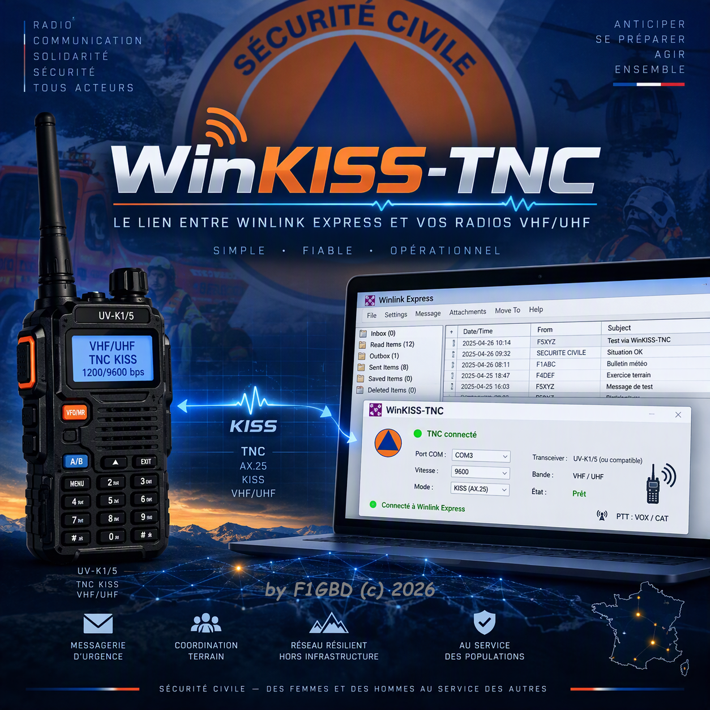
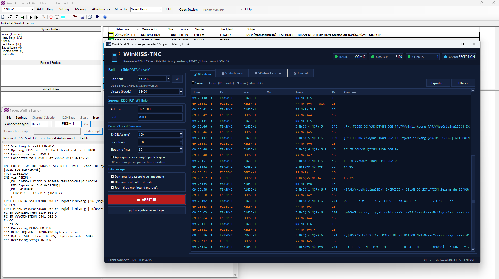
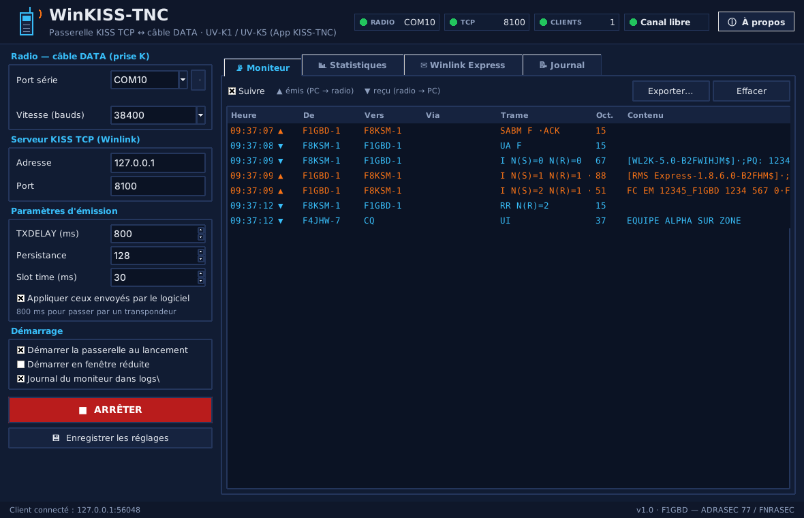
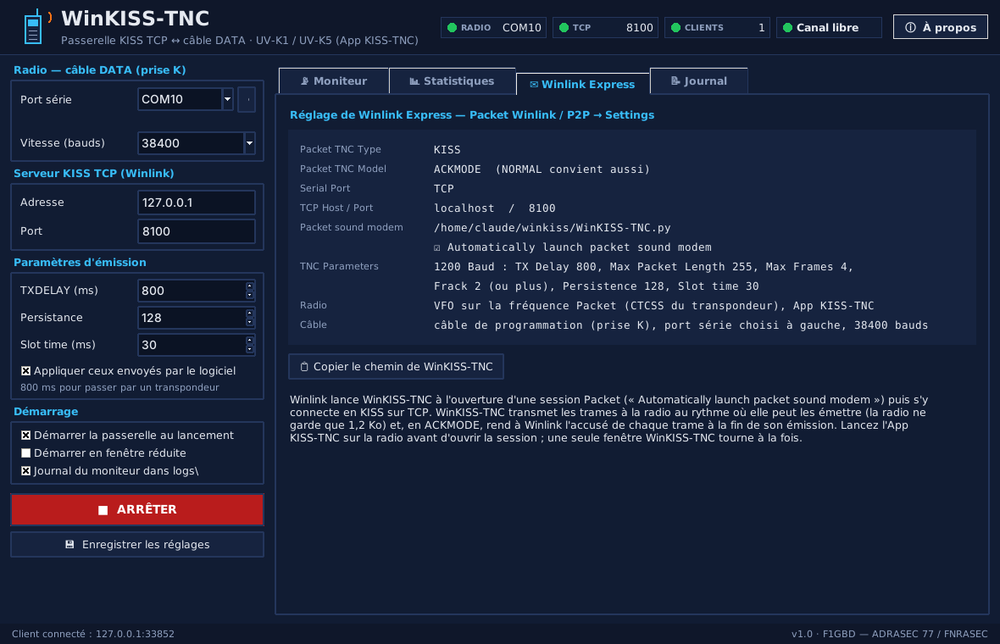

# WinKISS-TNC — Winlink Express en Packet avec un Quansheng UV-K1 / UV-K5

<p align="center"></p>

**WinKISS-TNC** relie **Winlink Express** (Packet Winlink, Packet P2P) — ou tout
logiciel « KISS sur TCP » (TCQ, Paracon, Outpost…) — à un portatif **Quansheng
UV-K1 / UV-K5 v3** sous l'application **[KISS-TNC](https://github.com/f1gbd/F1GBD/blob/master/quansheng/apps/KISS-TNC.md)**
(firmware F4HWN), par le simple **câble de programmation** (câble DATA, prise K).
Il prend la place de **Soundmodem** ou de **Direwolf** dans le réglage
« Packet sound modem » de Winlink : plus de carte son, plus de réglage de niveau,
plus d'interface PTT.

```
Winlink Express ── KISS TCP 127.0.0.1:8100 (ACKMODE) ──► WinKISS-TNC ──► COMx 38400 bauds ──► UV-K1 / KISS-TNC ──► AX.25 1200 bauds
```

[](https://github.com/f1gbd/F1GBD/releases?q=winkiss-tnc-v)

## 📥 [Télécharger l'installeur Windows](https://github.com/f1gbd/F1GBD/releases/download/winkiss-tnc-v1.0/WinKISS-TNC-1.0-setup.exe)

*Double-clic, aucun droit administrateur (installé dans `C:\WinKISS-TNC`). Binaire autonome — aucune installation Python.*
*Ensuite, WinKISS-TNC se met à jour tout seul : **ⓘ À propos → 🔄 VÉRIFIER LES MISES À JOUR**.*

Autres formats : [archive portable `WinKISS-TNC.7z`](https://github.com/f1gbd/F1GBD/releases/download/winkiss-tnc-v1.0/WinKISS-TNC.7z) · [empreinte SHA-256 de l'installeur](https://github.com/f1gbd/F1GBD/releases/download/winkiss-tnc-v1.0/WinKISS-TNC-1.0-setup.exe.sha256) · [toutes les versions](https://github.com/f1gbd/F1GBD/releases?q=winkiss-tnc-v)

## Essai réel : Winlink Express sur le RMS Packet F8KSM-1 avec un UV-K1

<p align="center"></p>
<p align="center"><em>12 octobre 2026 : Winlink Express 1.8.6.0 (F1GBD-1), session Packet Winlink lancée sur WinKISS-TNC v1.0 ;
câble DATA CH340 sur COM10 à 38400 bauds, UV-K1 sous KISS-TNC en UHF. Connexion au RMS F8KSM-1 (ADRASEC — Zone IDF),
échange B2F et lecture des messages Winlink en attente ; à droite, le moniteur de WinKISS-TNC : trames I du RMS et
accusés RR de Winlink, en ACKMODE.</em></p>

**Documentation** : [manuel d'installation et d'utilisation (PDF)](documentation/WinKISS-TNC_Manuel_v1.0.pdf).

<p align="center"></p>
<p align="center"><em>Le moniteur : trames émises (▲) et reçues (▼), connexion AX.25 décodée (SABM, UA, I, RR…)</em></p>

## Ce que fait WinKISS-TNC

| Fonction | Détail |
|---|---|
| Serveur KISS TCP | `127.0.0.1:8100` par défaut (celui de Winlink), plusieurs clients à la fois |
| KISS ACKMODE | trames `0x0C` de Winlink : la trame part vers la radio et l'accusé est rendu à Winlink **à la fin estimée de son émission** (TXDELAY + durée à 1200 bauds), ce qui arme le FRACK au bon moment ; mode NORMAL accepté aussi |
| Rythme | la radio ne garde que 1,2 Ko en attente : WinKISS-TNC garde la file et la lui donne **au rythme où elle peut émettre** (900 octets au plus) — les 4 trames de 255 octets de Winlink passent sans débordement |
| Canal occupé | une trame reçue pendant l'attente repousse l'estimation de l'émission et des accusés |
| Paramètres | TXDELAY, persistance, slot time envoyés à la radio à l'ouverture du port ; ceux de Winlink appliqués (option) |
| Radio → PC | chaque trame AX.25 reçue est envoyée à tous les clients |
| Moniteur | trames décodées (indicatifs, répéteurs, type I/S/U, N(S)/N(R), texte), export, journal quotidien dans `logs\` |
| Lancement par Winlink | démarre seul (passerelle active au lancement, écran d'accueil), une seule fenêtre même si Winlink le relance à chaque session ; port série réessayé toutes les 3 s s'il est absent |
| À propos | version, licence Apache 2.0, GitHub et **🔄 Vérifier les mises à jour** : téléchargement de l'installeur publié, contrôle SHA-256, mise à jour sur place (réglages conservés) |

## Installation

1. Télécharger **[WinKISS-TNC-1.0-setup.exe](https://github.com/f1gbd/F1GBD/releases/download/winkiss-tnc-v1.0/WinKISS-TNC-1.0-setup.exe)** (release `winkiss-tnc-v1.0`) et l'installer
   (`C:\WinKISS-TNC`, sans droits administrateur).
2. Installer l'App **KISS-TNC** sur la radio avec l'[UV-K1 Apps Uploader](https://f1gbd.github.io/F1GBD/quansheng/).
3. Brancher le câble de programmation (prise K) ; lancer WinKISS-TNC une première fois,
   choisir le **port série** du câble (CH340, CP210x… proposés en tête), **38400** bauds,
   **Enregistrer les réglages**.

## Réglage de Winlink Express

Packet Winlink (ou P2P) → **Settings** :

| Réglage | Valeur |
|---|---|
| Packet TNC Type | **KISS** |
| Packet TNC Model | **ACKMODE** (NORMAL convient aussi) |
| Serial Port | **TCP** |
| TCP Host / Port | **localhost** / **8100** |
| Packet sound modem | **`C:\WinKISS-TNC\WinKISS-TNC.exe`** |
| Automatically launch packet sound modem | ☑ |
| TNC Parameters (1200 Baud) | TX Delay **800**, Max Packet Length 255, Max Frames 4, Frack 2 (ou plus), Persistence 128, Slot time 30 |

<p align="center"></p>
<p align="center"><em>L'onglet Winlink Express rappelle ces réglages et copie le chemin de WinKISS-TNC</em></p>

Sur la radio : VFO sur la fréquence Packet (décalage et **CTCSS du transpondeur**,
puissance), puis **Apps → KISS-TNC**, **avant** d'ouvrir la session Winlink.

## Liens

- App radio **KISS-TNC** et UV-K1 Apps Uploader : https://github.com/f1gbd/F1GBD/tree/master/quansheng
- **TCQ v14.3.1** (TNC Packet en mode série directement sur le câble DATA) : https://github.com/f1gbd/F1GBD/tree/master/tcq

---

Jean-Louis Naudin **F1GBD** — ADRASEC 77 / FNRASEC — Licence Apache 2.0 — 73
