<p align="center">
  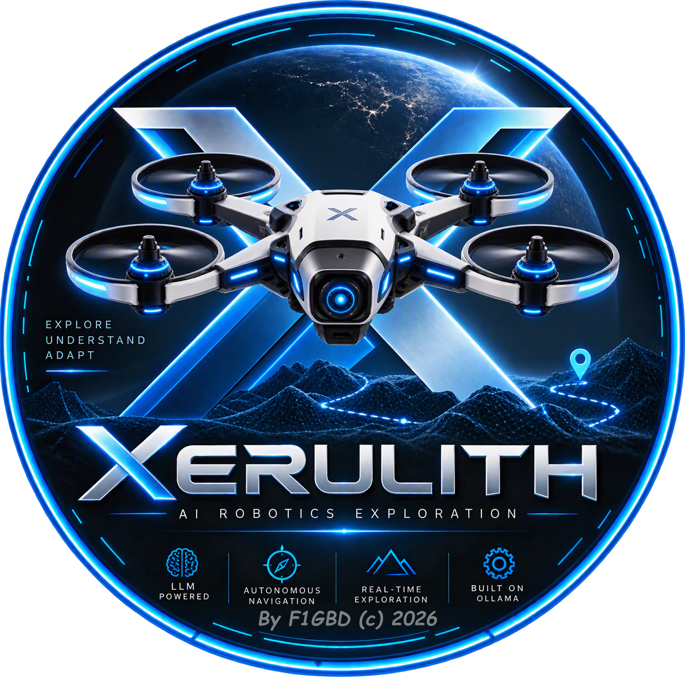
</p>

<h1 align="center">XERULITH</h1>

<p align="center">
  <b>L'IA aux commandes, l'humain aux décisions.</b><br>
  Plateforme de R&amp;D et de formation pour le <b>pilotage</b> et l'<b>exploration autonome</b> de robots,
  de drones et de rovers : un <b>pilote IA</b> mène la mission de bout en bout, des <b>garde-fous indépendants</b>
  vérifient chaque ordre, et tout s'apprend d'abord <b>en simulation</b>, puis sur le terrain, <b>même sans Internet</b>.
</p>

<p align="center">
  
  
  
  
  
  
  
  
</p>

<p align="center">
  <a href="documentations/XERULITH_Fiche_Presentation_Formation.pdf">
    
  </a>
  &nbsp;
  <a href="documentations/Manuel_Utilisateur_XERULITH.pdf">
    
  </a>
  &nbsp;
  <a href="documentations/XERULITH_Robot-IA_Fiche_Technique.pdf">
    
  </a>
</p>

## Ce que XERULITH apporte

| | |
|---|---|
| 🧠 **Un pilote IA de bout en bout** | La mission est écrite en français ; le pilote IA (Ollama, en local ou dans le cloud) enchaîne seul perception, décision et action jusqu'au compte rendu, et explique chacun de ses choix. |
| 🛡️ **L'humain garde la main** | Chaque ordre de l'IA est vérifié localement (limites, batterie, distances, zone) ; **STOP** partout, mode « Confirmer chaque plan », reprise à la radiocommande, sécurité ArduPilot en cas de perte de liaison. |
| 🎓 **Former sans risque, progresser par étapes** | Simulateur intégré, drone et rover **Arma 3**, simulateur **ArduPilot SITL** sur la carte d'un **terrain connu**, puis véhicule réel : mêmes écrans, mêmes missions, mêmes garde-fous. |
| 🛰️ **Des exercices de sécurité civile évalués** | Recherche de **balise de détresse 121,5 MHz** (radiogoniométrie), **départs de feu** en caméra thermique, **reconnaissance de zone**, exploration terrestre, **recherche de victimes par un robot humanoïde** en zone contaminée ou hostile, **reconnaissance de zone par le robot** : tirés au hasard, puis **notés** pour l'instructeur. |
| 📡 **Résilient, même hors réseau** | IA locale, **Mission Planner OFF-GRID** sans aucune dépendance à Internet, cartes préchargées, **pont radio LoRa 868 MHz** vers le véhicule. |
| 🔌 **Un seul poste pour toute la flotte** | EZ-Robot (JD-Humanoid, hexapodes, rovers), **ArduPilot** (ArduCopter, ArduRover, bateau), SunFounder GalaxyRVR, cartes ESP32 / Arduino, drone et rover Arma 3 : un **profil** suffit. |
| 🗺️ **Un robot qui apprend le terrain** | Le robot humanoïde observe, ramasse et examine les objets, entre dans les bâtiments, prend le volant d'un véhicule ; il dresse la **carte commentée** de la zone et garde une **mémoire de terrain** (RAG) avec ses **leçons**, réutilisées à la mission suivante. |
| 📝 **Tout est tracé** | Journal, panoramas, positions, **rapport de mission rédigé** par l'IA et évaluation de l'exercice : de quoi débriefer et comparer les modèles d'IA. |

## 📣 Pré-annonce

XERULITH est présenté ici **en avant-première par sa documentation** : fiche de présentation, manuels et fiches
techniques ci-dessous. Le **programme d'installation pour Windows 10 / 11** (et Mission Planner OFF-GRID) sera
proposé au téléchargement sur cette page lors de la publication du logiciel.

**Nouveautés v0.6** : **robot humanoïde IA** dans Arma 3 (modèle 3D XERULITH, animations des personnages d'Arma) pour la **recherche de victimes après un SATER** en zone **contaminée** (détecteur de rayonnement, dose reçue) ou **hostile** (patrouille armée) · vues extérieures 3ᵉ personne et orbite d'un clic (bouton 🎥 Vue) · le mannequin d'origine reste disponible sans mod · **v0.6.1** : **reconnaissance et exploration de zone** par le robot (observer, ramasser et examiner un objet, entrer dans un bâtiment, conduire un véhicule), **carte de reconnaissance**, **mémoire de terrain** entre les missions et leçons tirées par l'IA, robot en vue à la 3ᵉ personne · **v0.6.2** : **SATER au sol**, le robot retrouve une balise ELT 121,5 MHz à l'**antenne Yagi 3 éléments** tenue à la main (radioguidage par tours d'horizon, approche finale, balise arrêtée), avec le **son de la balise** au poste, du souffle au signal net selon la direction. **Reconnaissance en zone hostile** (pont 2.2) : véhicules blindés vides ou avec équipage et patrouille armée déposés au hasard, détecteur de blindés, missions pour le drone et le robot, évaluation du repérage.

**Nouveautés v0.5** : véhicules **ArduPilot** réels et simulés (ArduCopter, ArduRover) en mode GUIDED, décollage, atterrissage, RTH · lancement du **simulateur ArduPilot hors ligne** en un clic · **exercice SATER** au simulateur avec balise ELT simulée et évaluation instructeur · **Mission Planner OFF-GRID** : entraînement en **terrain connu**, carte téléchargée une fois, départ du drone choisi d'un clic · **pont radio LoRa 868 MHz** MAVLink (Heltec V3), flasheur et réglages intégrés · zone de recherche libre pour les missions SATER et feu.

📚 **Documentation** : [🎓 Présentation : XERULITH pour la formation](documentations/XERULITH_Fiche_Presentation_Formation.pdf) · [📖 Manuel utilisateur](documentations/Manuel_Utilisateur_XERULITH.pdf) · [🛠 Manuel technique](documentations/XERULITH_Manuel_Technique.pdf) · [🛩 Fiche simulateur ArduPilot / Mission Planner](documentations/XERULITH_Fiche_Test_SITL_ArduPilot.pdf) · [📡 Fiche pont LoRa 868 MHz](documentations/XERULITH_Fiche_Pont_LoRa_MAVLoRa.pdf) · [🚙 Fiche rover hors réseau](documentations/XERULITH_Fiche_Rover_OffGrid.pdf) · [🎮 Fiche réflexe Arma 3](documentations/XERULITH_Fiche_Reflexe_Arma3_Ollama.pdf) · [🤖 Fiche GalaxyRVR](documentations/XERULITH_Fiche_GalaxyRVR.pdf) · [🖥 Fiche configurations recommandées (Arma 3, Ollama local et cloud)](documentations/XERULITH_Fiche_Configurations_Recommandees.pdf) · [✍ Fiche créer une mission et rédiger son prompt](documentations/XERULITH_Fiche_Creer_Mission_Prompt.pdf) · [🤖 Fiche technique Robot-IA](documentations/XERULITH_Robot-IA_Fiche_Technique.pdf) · [🔲 Repères ArUco 10 cm à imprimer](documentations/XERULITH_Reperes_ArUco_10cm.pdf)

---

## Le projet

**XERULITH** est né sur un mini-robot humanoïde **EZ-Robot JD-Humanoid** et pilote aujourd'hui
toute une famille de plateformes, chacune décrite par un **profil** :

| Plateforme | Exemples | Apport de XERULITH |
|---|---|---|
| **EZ-Robot** (carte EZ-B v4, Wi-Fi) | JD-Humanoid, hexapodes et quadrupèdes (actions ARC), rovers, tourelles | équivalent d'ARC sans restriction, lecture directe des projets ARC |
| **ArduPilot / MAVLink** | ArduCopter, ArduRover, ArduSub, bateau | station sol légère : télémétrie, armement, consignes limitées ; navigation GUIDED et missions autonomes (v0.5) |
| **SunFounder GalaxyRVR** | rover martien 6 roues, firmware d'origine | caméra, ultrason, infrarouges sans reprogrammation |
| **Cartes maison** | ESP32, Arduino en série ou TCP | commandes texte, mesures `CLE=valeur`, NMEA |
| **Arma 3** (simulation) | drone AR-2 Darter, rover UGV Stomper | vol et conduite physiques, vidéo de la tourelle avec HUD, missions de formation évaluées |
| **Simulateur intégré** | JD simulé, rover virtuel | essais sans matériel |

### Le pilote IA Ollama : autonomie complète, en local ou dans le cloud

La mission est donnée en français ; XERULITH enchaîne seul les cycles **perception → décision →
action** jusqu'au compte rendu. Un modèle de vision décrit la scène, un modèle de décision choisit
les actions à partir de la mission, des capteurs et de sa mémoire, puis rédige le rapport. Chaque
ordre reste vérifié localement par XERULITH, quel que soit le modèle.

- **En local** (PC ou serveur du réseau) : autonomie totale **sans Internet**, données et images
  sur place, latence maîtrisée.
- **Dans le cloud** (Ollama Cloud, clé API) : grands modèles sans GPU local, même interface et
  mêmes garde-fous.
- **Automatique** : réseau local d'abord, cloud en secours.

Le même pilote commande un JD, un rover, un véhicule ArduPilot ou le drone simulé : seule la
description du profil change.

### Arma 3 : former et tester les missions avant le terrain

Le drone virtuel d'Arma 3 permet de **former** opérateurs et pilotes IA sans risque ni matériel,
de **mettre au point une mission** (texte, limites, choix du modèle) avec les mêmes modes, garde-fous,
journal et rapport que sur un robot réel, et de jouer des **exercices générés au hasard et évalués**
(balise 121,5 MHz SATER, départ de feu en caméra thermique, reconnaissance de zone). Parcours conseillé :
simulateur intégré → Arma 3 → plateforme réelle en mode « Confirmer chaque plan ».

<p align="center">
  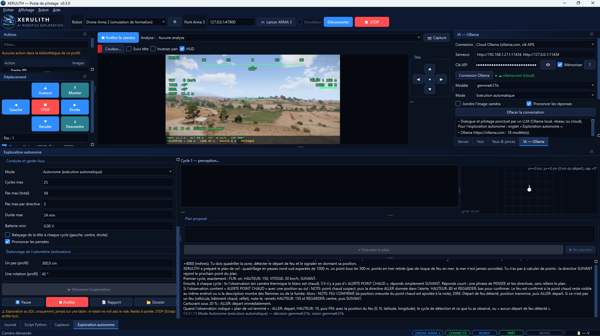<br>
  <i>Poste de pilotage connecté au drone Arma 3 : vidéo avec le HUD de XERULITH, déplacement et RTH, IA — Ollama, exploration autonome.</i>
</p>

## Fonctions

### Pilotage à distance (équivalent ARC)

| Panneau | Rôle |
|---|---|
| **Connexion** | IP de l'EZ-B (`192.168.1.65:23` par ex.), **🔍 Scanner** du réseau, **simulateur intégré**, Connecter (**F5**), Calibrer, **STOP** (touche Échap), Relâcher (avec confirmation), autorisation des acrobaties |
| **Caméra** | Image en direct, capture, pavé de tête. Analyses : couleur, QR, visages, marqueurs ArUco, mouvement, objets. **Suivi de cible** par la tête |
| **Actions** | Les 39 mouvements du JD classés par risque (geste, déplacement, acrobatie), boucles, vitesse |
| **Déplacement** | Avancer, reculer, tourner, au pavé ou au clavier (flèches ou ZQSD), poses ; **⌂ RTH** (touche H) : retour au point de départ du drone, du rover Arma 3 ou d'un véhicule ArduPilot (mode RTL) |
| **Servos** | 16 curseurs avec nom et course autorisée de chaque articulation |
| **Voix** | Synthèse vocale sur le haut-parleur du robot (voix Windows ou Piper), reconnaissance vocale par le micro du PC, commandes vocales modifiables |
| **Yeux et pinces** | Animations des yeux RGB, ouverture des pinces |
| **Script Python** | Éditeur et console. Tout le langage Python est permis, plus l'objet `robot` (`robot.avancer(2)`, `robot.dire(…)`, `robot.voir("visages")`…) |
| **IA — Ollama** | Dialogue avec un LLM (Ollama en local, sur le réseau ou dans le cloud avec une clé API), qui propose des ordres de pilotage. Chaque ordre est vérifié avant d'être exécuté |
| **Capteurs** | Mesures en direct des capteurs du profil (distance, GPS, cap, profondeur…), courbes de batterie et de température, entrées de la carte EZ-B |

### Profils de robot

XERULITH ne pilote plus seulement le JD. Un **profil** décrit le robot : son type, son
contrôleur, sa façon de se déplacer, ses servos, sa tête et ses capteurs. On le choisit dans
la barre de connexion, et l'éditeur (bouton ⚙ ou menu **Robot → Profils de robot…**) permet
d'en créer, dupliquer, importer ou exporter.

| Contrôleur | Déplacement | Capteurs affectables |
|---|---|---|
| **EZ-B v4** (Wi-Fi) | actions du JD, actions d'un projet ARC (.EZB), deux servos à rotation continue, pont en H (4 sorties + 2 PWM) | caméra EZ-B, ultrason I2C SRF02/08/10, capteur analogique (MaxBotix, Sharp), GPS NMEA sur UART, tension de batterie, entrées analogiques et numériques |
| **ArduPilot / MAVLink** (ArduRover, ArduSub, bateau) | consignes RC limitées dans le temps, armement et mode depuis la barre | GPS, cap, batterie, télémètres (DISTANCE_SENSOR), profondeur, caméra IP |
| **SunFounder GalaxyRVR** (Wi-Fi, firmware d'origine 1.x ou 2.x) | moteurs gauche et droite, inclinaison de la caméra | caméra ESP32-CAM, ultrason, deux détecteurs d'obstacle infrarouges, batterie |
| **Drone Arma 3** (pont Pythia `@XerulithBridge`) | consignes de vol (pas, cap, hauteur), points de la carte `ALLER` / `VOLER`, vol physique d'Arma | capture de la fenêtre du jeu, télémètre, position, cap, hauteur, vitesse, carburant, radiogoniomètre 121,5 MHz |
| **Rover UGV Arma 3** (même pont) | pas avant / arrière, rotation sur place, trajets `ALLER` / `ROULER` par l'IA conductrice d'Arma, contournement automatique | capture de la fenêtre du jeu, télémètre, position, cap, vitesse, tangage, roulis, détecteur d'objets simulé |
| **Carte maison** (ESP32, Arduino… en série ou TCP) | commandes texte paramétrables (`F {v} {ms}`…) | toute valeur renvoyée en `CLE=valeur`, trames NMEA, caméra IP ou USB |
| **Simulateur** | rover virtuel dans une pièce de 4 m × 3 m | distance, GPS, cap, profondeur, batterie, caméra de synthèse |

<p align="center">
  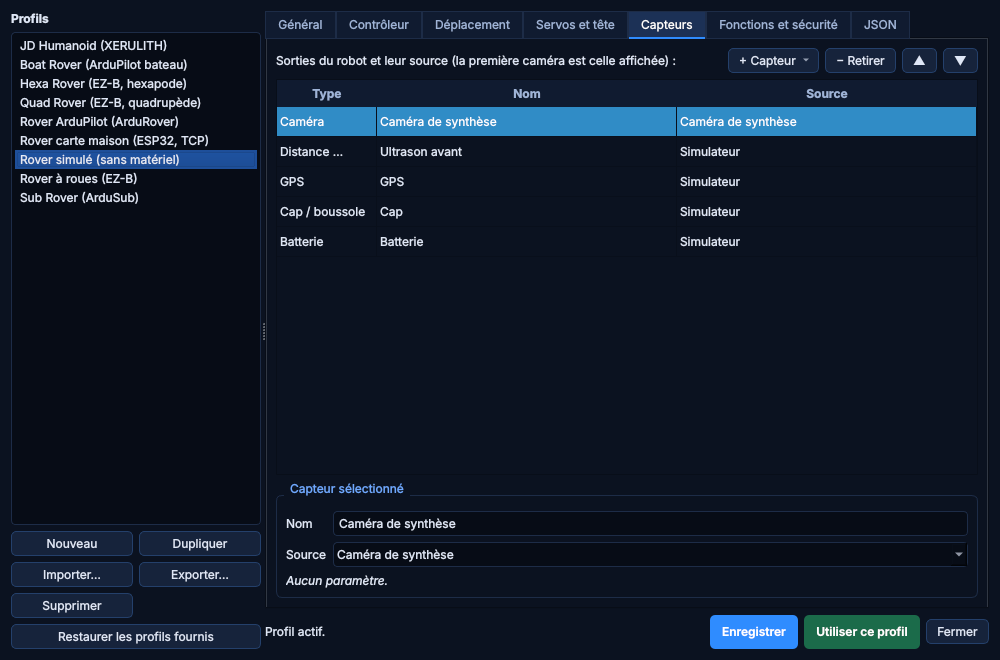<br>
  <i>Éditeur de profils : affectation des capteurs et de leur source.</i>
</p>

Profils fournis : **JD Humanoid**, **Hexa Rover**, **Quad Rover**, **Rover à roues**,
**Rover ArduPilot**, **Sub Rover** (ArduSub), **Boat Rover**, **SunFounder GalaxyRVR**,
**Drone Arma 3**, **Rover UGV Arma 3**, **Rover carte maison** et **Rover simulé**. Le GalaxyRVR se pilote sans reprogrammation :
XERULITH parle à son ESP32-CAM comme l'application SunFounder Controller. Les panneaux s'adaptent au profil (servos, actions, yeux, boutons Monter et
Descendre d'un sous-marin ou d'un drone, bouton Armer d'un véhicule ArduPilot), et l'IA
reçoit la description du robot et les mesures de ses capteurs.

### Drone virtuel Arma 3 (simulation de formation)

XERULITH pilote un drone de reconnaissance **AR-2 Darter** dans le simulateur **Arma 3**, avec
le **modèle de vol du jeu** (inertie, inclinaison, vent, freinage) : au pavé, par script, ou par
le pilote autonome Ollama. La vidéo est la vue d'une caméra fixée au véhicule, capturée dans la
fenêtre du jeu sans l'interface d'Arma ; XERULITH y superpose **son propre HUD**, construit à partir
de la télémétrie : bande de cap avec repères (départ, cible, objets détectés, balise 121,5 MHz),
horizon artificiel, vitesse, hauteur, assiette, télémètre, carburant, position. Ce HUD fonctionne
avec toute source vidéo (Arma 3, caméra IP, ESP32-CAM, webcam) et n'est jamais envoyé au pilote IA.

| Élément | Rôle |
|---|---|
| Mod **Pythia** (Steam Workshop) | Python 3 dans Arma 3 |
| Mod **`@XerulithBridge`** (livré dans le dossier `arma3` de XERULITH) | serveur TCP `127.0.0.1:47800` dans le jeu, ordres bornés, addon minimal `xerulith_bridge.pbo` |
| `init.sqf` + `xerulith_bridge.sqf` | mission : drone à 10 m devant le joueur (ou rover UGV avec `mission_rover`), pilote automatique, maintien de hauteur, de position et de cap, caméra du véhicule |

Mise en route, sur **un seul PC** :

1. Copiez `@XerulithBridge` (complet : `addons\` et `python_code\`) dans le dossier d'Arma 3,
   à côté de `arma3_x64.exe`, et abonnez-vous à **Pythia** sur le Steam Workshop.
2. Dans XERULITH, profil Arma 3, bouton **🎮 Lancer ARMA 3** : Arma démarre avec les mods,
   en mode fenêtré, avec `-noPause -noPauseAudio` et sans BattlEye (la mission peut même s'ouvrir
   directement, réglage du profil). À la main : lanceur d'Arma 3, onglet **Mods**, `@XerulithBridge`
   en mod local avec `@Pythia` ; onglet **Paramètres** : **Mode fenêtré**, `-noPause -noPauseAudio`,
   **BattlEye désactivé**.
3. Créez une mission dans l'éditeur Eden (un joueur sur la carte), enregistrez-la et copiez
   `init.sqf` et `xerulith_bridge.sqf` dans son dossier
   (`Documents\Arma 3 - Other Profiles\<profil>\missions\<nom>.<carte>\`), puis lancez-la.
4. Dans XERULITH : profil **Drone Arma 3** (ou **Rover UGV Arma 3**), adresse `127.0.0.1:47800`, **Connecter**, puis
   **Démarrer la caméra**. Laissez la fenêtre d'Arma visible, idéalement sur un second écran.

En exploration autonome, le pilote dispose de `ALLER: <est> <nord> [vitesse]` (mètres depuis
le point de départ), `ALLER: depart`, `VOLER: <cap> <distance> [vitesse]`, `HAUTEUR: <m>` et
`VITESSE: <m/s>|max`, `FLIR: on|off` et `SUIVANT` (prochain point du plan de vol préparé par
XERULITH). Trois missions de formation sont fournies :

- **Reconnaissance 1 km² et retour** : 6 passes nord-sud espacées de 200 m (18 points),
  notes de chaque élément remarquable, retour au départ et rapport ;
- **SATER : recherche de balise 121,5 MHz** : une épave et sa balise ELT sont placées au hasard
  (position cachée) ; le pilote rallie la balise par relèvements successifs du radiogoniomètre
  simulé (niveau en dBm, masquage par le relief), l'identifie à l'image et rentre. Le rapport
  ajoute une évaluation instructeur (distance à la balise) ;
- **Surveillance incendie FLIR 20 km²** : un départ de feu est placé au hasard dans une zone de
  5 km × 4 km ; le drone, en caméra thermique, quadrille la zone à 30 km/h selon le plan de vol préparé par XERULITH
  (5 passes, `SUIVANT`, jamais au-dessus de la mer), localise le point chaud au sol (E, N,
  latitude, longitude), confirme le feu et le signale. En formation, le feu est placé près d'un point
  de passage : il est toujours détectable.

Le pont embarque un **détecteur thermique simulé**, comme la boule FLIR d'un vrai drone : il voit le
foyer dans le champ de la caméra et le **panache chaud** jusqu'à 3 km, même derrière le relief. Quand
le foyer est visible mais hors de l'image (sous le drone), XERULITH **pointe automatiquement la
caméra** dessus. Chaque point chaud mesuré au sol déclenche une **tonalité d'alerte**, une **photo
annotée de la zone** (`point_chaud_NN.jpg`) et l'enregistrement de ses coordonnées (E / N, latitude
et longitude en degrés décimaux et en degrés, minutes, secondes) dans `points_chauds.csv` ; le
rapport de mission les reprend.

<p align="center">
  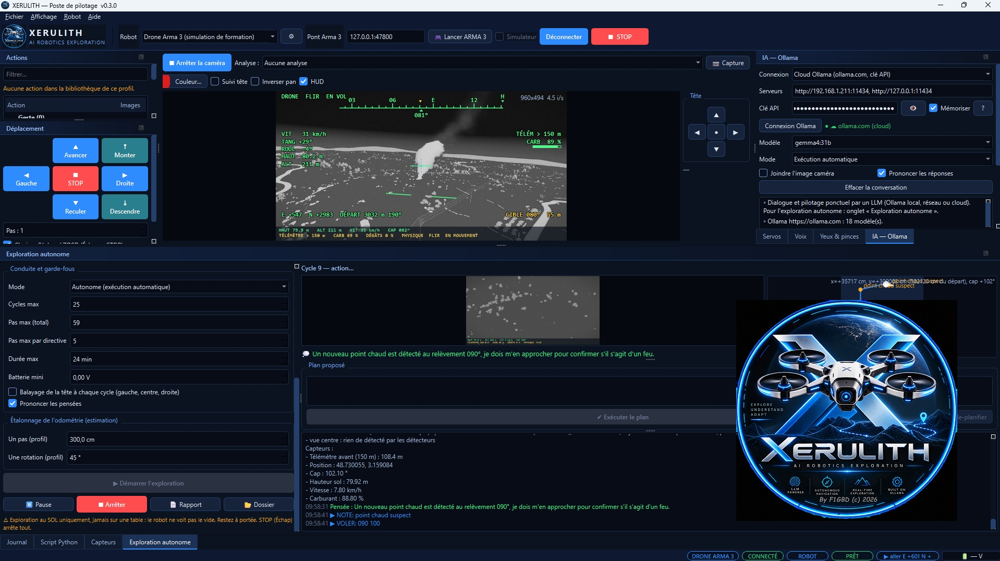<br>
  <i>Caméra thermique : le panache du départ de feu est détecté au relèvement 090°, le pilote IA note « point chaud suspect » et s'en approche.</i>
</p>

<p align="center">
  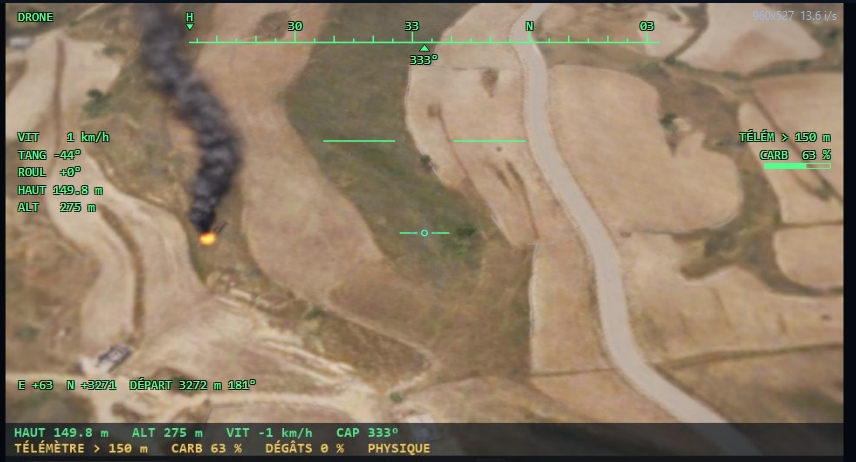<br>
  <i>Confirmation en vision normale : foyer et fumée sous le drone, HUD de XERULITH (hauteur 150 m, cap 333°).</i>
</p>

### Rover UGV Arma 3 (exploration terrestre)

Le même pont pilote un **rover terrestre UGV Stomper** (mission d'exemple `mission_rover`, profil
**Rover UGV Arma 3**) : physique de conduite d'Arma, trajets `ALLER` / `ROULER` confiés à l'IA
conductrice du jeu (choix du chemin, contournement des obstacles), mesure de la pente (tangage,
roulis) avec alerte, trajet bloqué détecté puis **contournement automatique** par XERULITH, pas
d'entrée dans l'eau. Mission fournie, comme un rover d'exploration planétaire :

- **Exploration terrestre rover UGV 1 km²** : 5 objets (caisse, épave, tente, fûts, terminal…)
  sont déposés au hasard ; XERULITH prépare un parcours de 35 points (`SUIVANT`) ; un
  **détecteur d'objets embarqué** simulé signale chaque objet vu par la caméra avec sa position
  estimée ; le pilote s'en approche (`ALLER`) et l'identifie à moins de 15 m. Le rapport ajoute une
  évaluation instructeur (objets vus, approchés, signalés, écart, distance parcourue, pente maximale).

Le [manuel utilisateur](documentations/Manuel_Utilisateur_XERULITH.pdf) (chapitre 9) détaille
le paramétrage d'Arma 3, la mission, le pilotage, les missions autonomes et le dépannage ; le
[manuel technique](documentations/XERULITH_Manuel_Technique.pdf) décrit le protocole du pont
et les lois de commande du vol.

### Robot humanoïde IA Arma 3 (recherche de victimes, v0.6)

Un **robot humanoïde d'intervention** de 1,85 m, dessiné pour XERULITH : casque à **visière noire**
sans visage, caméras stéréo et module thermique, armure **céramique blanche**, **réacteur bleu** et
lidar thoracique, colonne d'énergie lumineuse dans le dos, mains à cinq doigts, grands pieds
stabilisés ; aucune arme. Il reprend le squelette des personnages d'Arma 3 : il marche, court et
franchit la végétation là où un véhicule ne passe pas. Profil **Robot humanoïde Arma 3**, mission
d'exemple `mission_robot`, jeu de base seulement (aucun DLC) ; sans le mod `@XerulithRobot`, le
mannequin d'origine repeint en blanc le remplace.

- **Recherche de victimes après un SATER, zone contaminée et hostile** : le drone a localisé
  l'épave ; 4 victimes (inconscientes, ou conscientes et blessées) sont placées au hasard autour.
  Le robot suit le parcours préparé par XERULITH, son **détecteur de personnes** lui signale chaque
  victime, il s'en approche et le pilote IA décrit son état à l'image. **Détecteur de rayonnement**
  (µSv/h, dose reçue, fumée jaune à la source) et **patrouille armée** à éviter (personnes armées
  en vue, fois où le robot est repéré). Fin : retour au départ, compte rendu pour les secours et
  **évaluation instructeur** (victimes localisées, écart de position, état noté, dose, menaces).

<p align="center">
  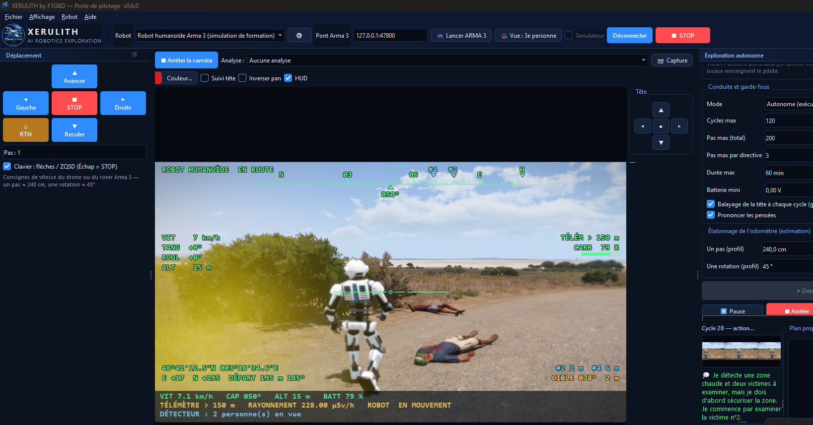<br>
  <i>Recherche de victimes après un SATER : le détecteur signale deux personnes au sol (#2 à 2 m, #4 à 6 m) ; le robot s'approche de la victime n°2 pour l'examiner, en zone contaminée (228 µSv/h).</i>
</p>

<p align="center">
  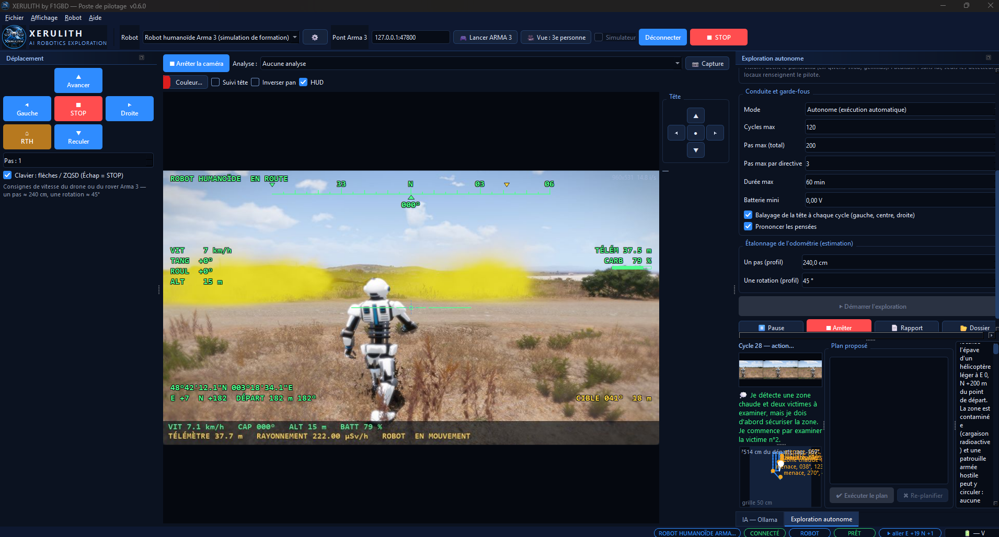<br>
  <i>Zone contaminée autour de l'épave, marquée par une fumée jaune : le détecteur de rayonnement mesure 222 µSv/h ; le pilote IA décide de terminer l'examen en cours avant de quitter la zone chaude.</i>
</p>

<p align="center">
  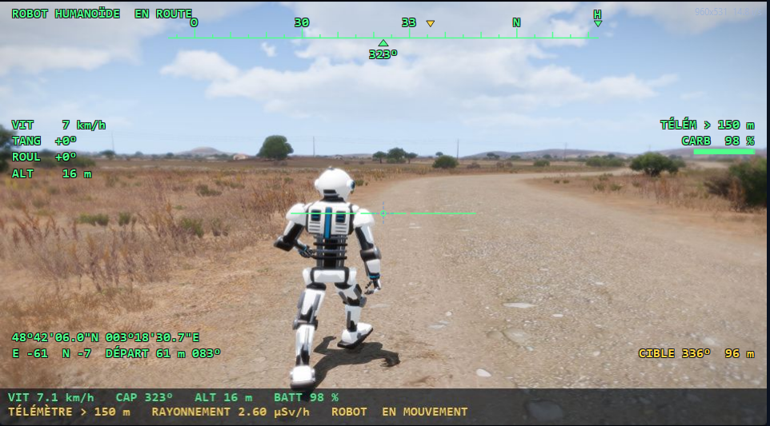<br>
  <i>Le robot humanoïde IA en route vers une victime, vu en 3ᵉ personne : HUD de XERULITH (cap, vitesse, batterie, rayonnement 2,6 µSv/h, cible à 96 m).</i>
</p>

<p align="center">
  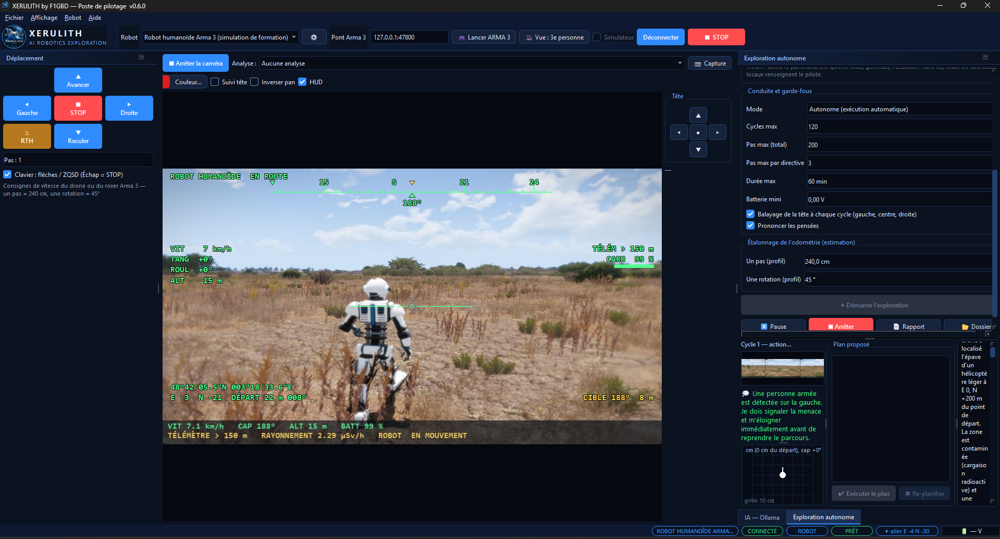<br>
  <i>Poste de pilotage v0.6 en exploration autonome : le pilote IA a repéré une personne armée sur la gauche, la signale et s'éloigne avant de reprendre le parcours.</i>
</p>

#### SATER au sol : balise ELT 121,5 MHz à l'antenne Yagi (v0.6.2)

Comme une équipe de recherche au sol : le robot porte une **antenne Yagi 3 éléments** (polarisation
verticale, 7 dBi, avant / arrière 15 dB) reliée à un récepteur 121,5 MHz. Sans radiogoniomètre, il trouve la
direction en **tournant sur lui-même** (tour d'horizon radio, une mesure tous les 30°), marche au relèvement
du maximum par pas de 200, 100 puis 50 m, recommence, et déjoue les réflexions du relief et des bâtiments.
Sous 150 m, XERULITH mène l'**approche finale** : tours rapprochés, épave repérée et examinée avec son
occupant, position notée, **balise arrêtée**. XERULITH **recoupe les relèvements** pris à des endroits
différents (position estimée de la balise) et empêche les allers-retours. Le haut-parleur du poste fait
entendre le récepteur comme un vrai récepteur AM : **souffle**, d'où sort le **son de la balise** d'autant
plus net que l'antenne est pointée vers elle, avec un **atténuateur automatique** près du but. L'évaluation
instructeur compare chaque relèvement trouvé au relèvement vrai.

<p align="center">
  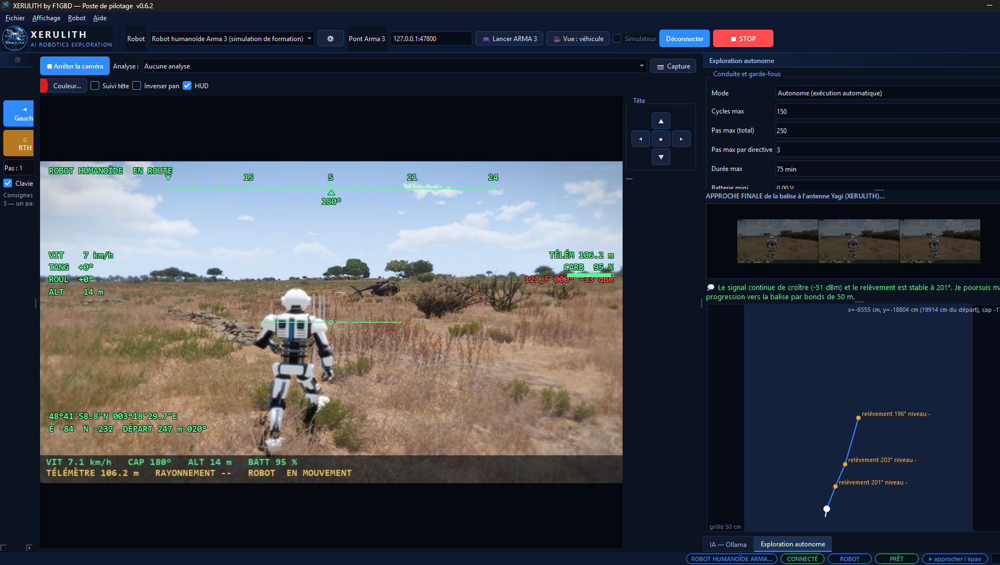<br>
  <i>Approche finale à l'antenne Yagi : le récepteur 121,5 MHz reçoit −33 dBm, l'épave de l'hélicoptère apparaît devant le robot ; à droite, la trace des derniers relèvements (196°, 203°, 201°).</i>
</p>

<p align="center">
  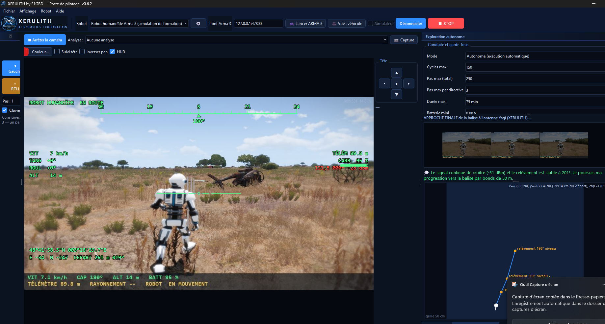<br>
  <i>Épave atteinte : le récepteur sature (−28 dBm) ; XERULITH repère l'épave au détecteur d'objets et l'examine avant d'arrêter la balise.</i>
</p>

<p align="center">
  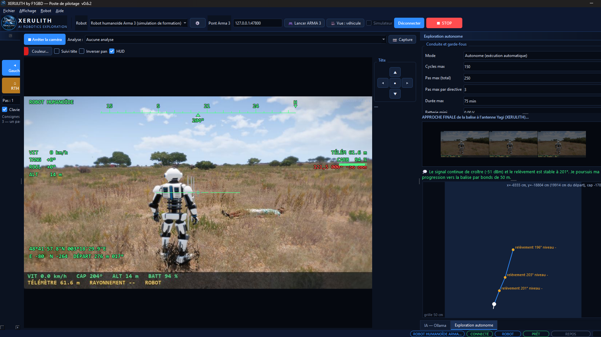<br>
  <i>L'occupant de l'aéronef, au sol près de l'épave : le robot s'arrête face à lui pour l'examiner sans contact et le décrire dans le compte rendu pour les secours.</i>
</p>

#### Reconnaissance et exploration de zone, avec mémoire de terrain (v0.6.1)

Le robot découvre une zone inconnue comme un éclaireur : à chaque point du parcours, tour d'horizon de la
tête ; son **détecteur d'objets** (lidar + vision) classe ce qui est en vue — véhicules, bâtiments, petits
objets, personnes — et XERULITH propose au pilote IA l'action la plus utile :

- **OBSERVER** : s'approcher, pointer la caméra, examiner (dimensions, masse, état, contenu, rayonnement) ;
- **RAMASSER** : saisir un petit objet, le tourner devant la caméra, le décrire, puis **le remettre à sa place** ;
- **ENTRER** : ouvrir les portes, visiter les pièces avec un tour d'horizon, examiner un objet trouvé, ressortir ;
- **EMBARQUER** : prendre le volant d'un véhicule civil, rouler une courte distance, regarder depuis la cabine, descendre.

Jamais de contact avec une arme, des munitions ou un engin suspect ; une personne s'observe sans la toucher.
Tout ce qui est vu et appris entre dans une **mémoire de terrain** (RAG, recherche par le lieu et par le sens
avec les embeddings d'Ollama) : à la mission suivante, le robot sait ce qu'il a déjà vu, ne réexamine pas ce
qui n'a pas changé, signale ce qui a bougé et applique les **leçons** qu'il a lui-même écrites. Fin de mission :
**carte de reconnaissance**, repères KML, photos et évaluation instructeur des objets d'intérêt déposés.

<p align="center">
  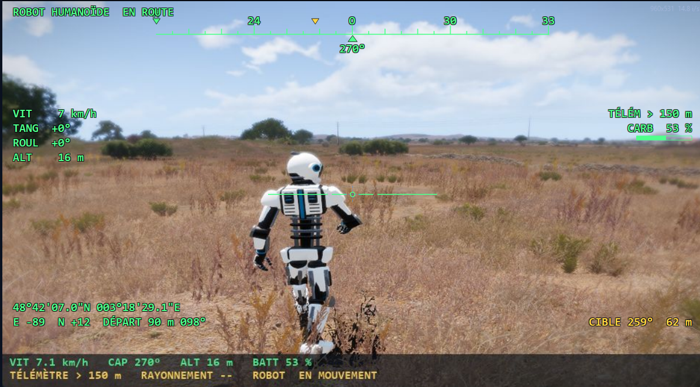<br>
  <i>Reconnaissance de zone en vue à la 3ᵉ personne : le robot rejoint le point suivant du parcours (cible à 62 m) en traversant la garrigue.</i>
</p>

<p align="center">
  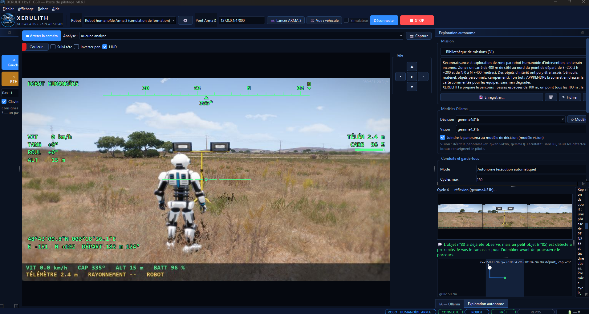<br>
  <i>Reconnaissance : arrêt devant un projecteur de chantier déjà observé (télémètre 2,4 m) ; le pilote IA repère un petit objet à proximité et décide de le ramasser pour l'identifier avant de poursuivre le parcours.</i>
</p>

<p align="center">
  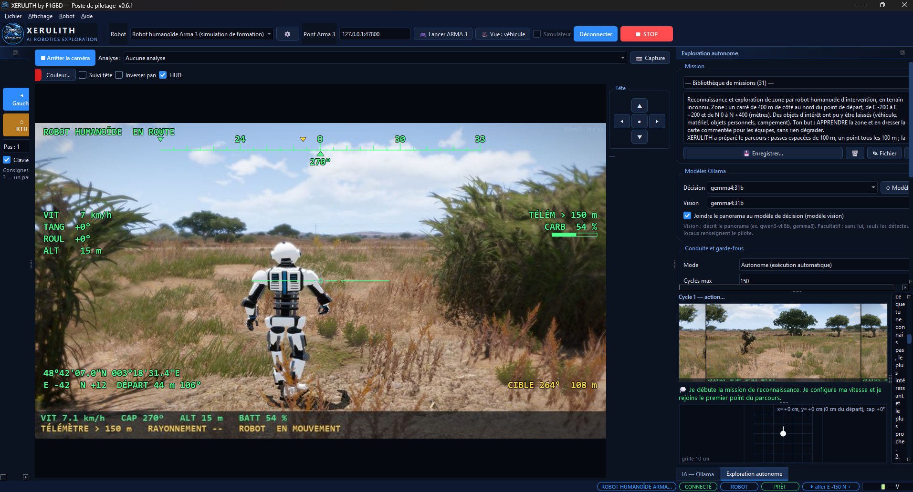<br>
  <i>Poste de pilotage v0.6.1 : mission de reconnaissance avec gemma4:31b en décision et en vision ; à droite, le panorama de la caméra de tête et la première décision du pilote IA.</i>
</p>

### ArduPilot réel et simulateur SITL (v0.5, en développement)

Les missions autonomes passent du simulateur Arma 3 aux **véhicules ArduPilot réels** (Pixhawk) : un
pilote MAVLink de navigation commande le drone ArduCopter ou le rover ArduRover en mode **GUIDED**
(`ALLER`, `VOLER` / `ROULER`, `HAUTEUR`, `SUIVANT`, cap), avec **RTH** (mode RTL), **POSER** (LAND) et
**DÉCOLLER** (TAKEOFF), nacelle pointée sur un point du sol, zoom et photo. XERULITH envoie un battement
de poste au sol : si la liaison est perdue, ArduPilot applique seul sa sécurité (RTL, arrêt). Une
reprise en main à la radiocommande (LOITER, HOLD…) arrête aussitôt le trajet en cours.

Tout s'essaie sans matériel avec le **SITL d'ArduPilot**, lancé par XERULITH (bouton **🛩 Lancer le simulateur**,
sans Internet) ou par Mission Planner (onglet Simulation), XERULITH connecté en `tcp:127.0.0.1:5763` : profils **Drone ArduCopter (SITL)** et **Rover ArduPilot
(SITL)**, fichiers de paramètres de simulation fournis (dossier `ardupilot` de XERULITH), missions d'essai
(parcours ArduCopter de 300 m, **exploration terrestre ArduRover de 1 km²** sans limite de distance ni
géobarrière). Voir la [fiche de test SITL / Mission Planner](documentations/XERULITH_Fiche_Test_SITL_ArduPilot.pdf).

<p align="center">
  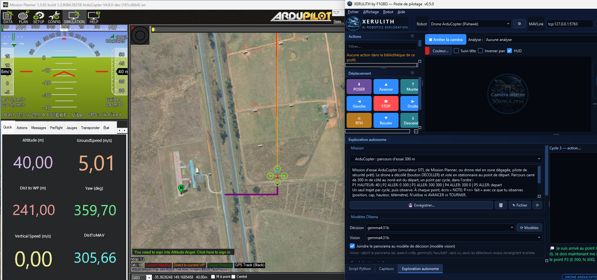<br>
  <i>Mission « ArduCopter : parcours d'essai 300 m » : Mission Planner (SITL ArduCopter 4.8, mode Guided, 40 m) et XERULITH, pilote IA gemma4:31b.</i>
</p>

<p align="center">
  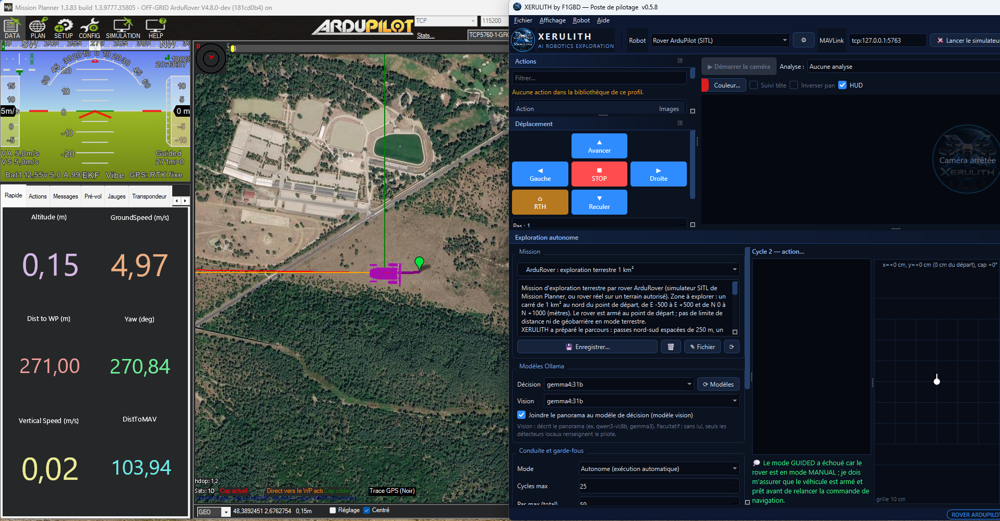<br>
  <i>Mission « ArduRover : exploration terrestre 1 km² » : rover ArduRover simulé (SITL 4.8, mode Guided, 4 m/s) sur le parcours préparé par XERULITH, profil Rover ArduPilot (SITL), pilote IA gemma4:31b.</i>
</p>

#### Formation SATER au simulateur, hors ligne et en terrain connu

**Mission Planner OFF-GRID**, édition fournie avec XERULITH (programme d'installation, sans droits administrateur),
fonctionne **sans aucune connexion à Internet** : simulateur local, cartes en cache, pas d'Altitude Angel, connexion
automatique au simulateur lancé par XERULITH. Son menu **OFF-GRID** (clic droit sur la carte) prépare un
**entraînement en terrain connu** : zone d'entraînement entourée sur la carte et téléchargée une fois avec Internet
(passage en ligne temporaire), **point de départ du drone choisi d'un clic** (simulateur relancé à cet endroit).

Exercice **« ArduCopter SITL : SATER recherche de balise 121,5 MHz »** : XERULITH pose au hasard dans la zone une
balise ELT simulée, cachée à l'IA et affichée dans Mission Planner comme un second véhicule (système 99) ; le
radiogoniomètre est simulé (relèvement, niveau). Le pilote IA rallie la balise au relèvement, puis XERULITH mène
l'approche finale et note sa position ; le rapport de fin donne à l'instructeur l'écart avec la vraie position.

<p align="center">
  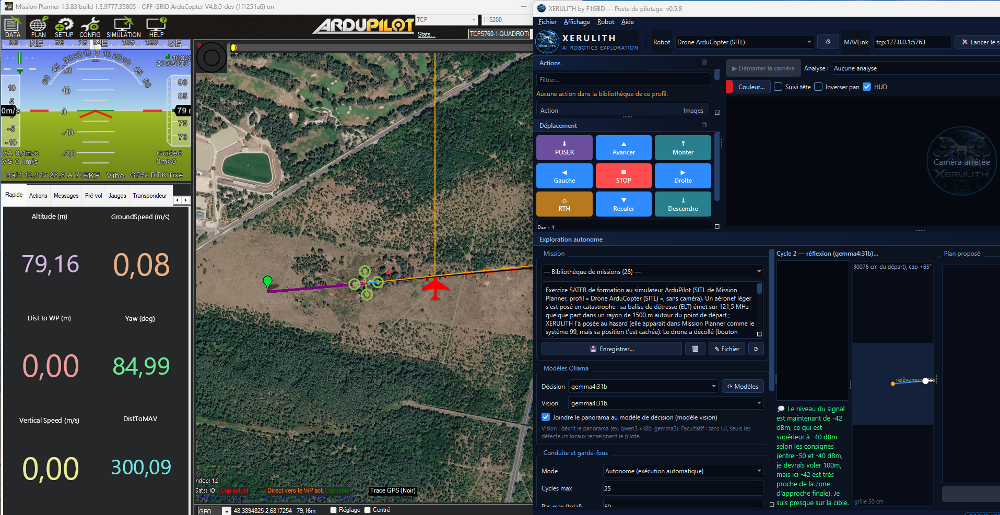<br>
  <i>Exercice SATER au SITL avec Mission Planner OFF-GRID : drone ArduCopter à 80 m, balise ELT simulée (avion rouge, système 99) ; à droite, le pilote IA gemma4:31b raisonne sur le niveau du signal (-42 dBm) avant l'approche finale.</i>
</p>

<p align="center">
  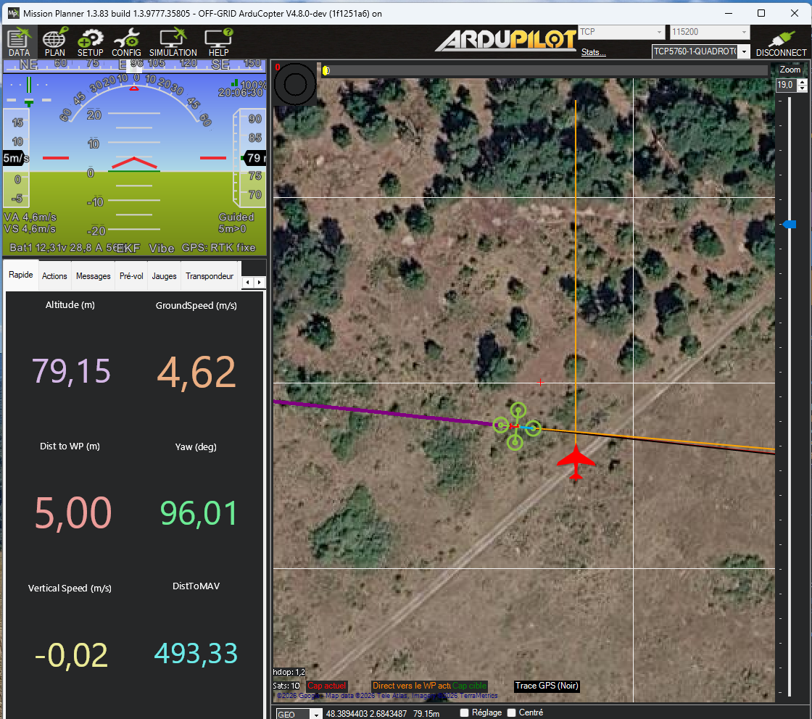<br>
  <i>Approche finale menée par XERULITH : drone orienté vers la balise, à quelques dizaines de mètres d'elle, sur la carte téléchargée du terrain d'entraînement (zoom 19), sans Internet.</i>
</p>

### Exploration autonome

<p align="center">
  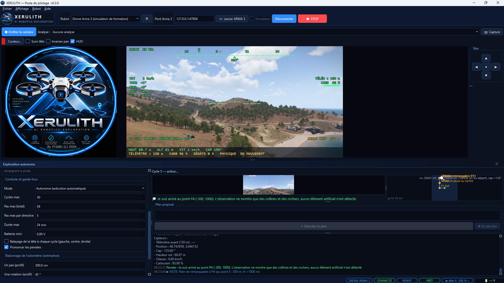<br>
  <i>Exploration autonome avec le drone Arma 3 : vidéo et HUD, réglages, panorama du cycle, pensée du pilote, trajectoire, journal.</i>
</p>

<p align="center">
  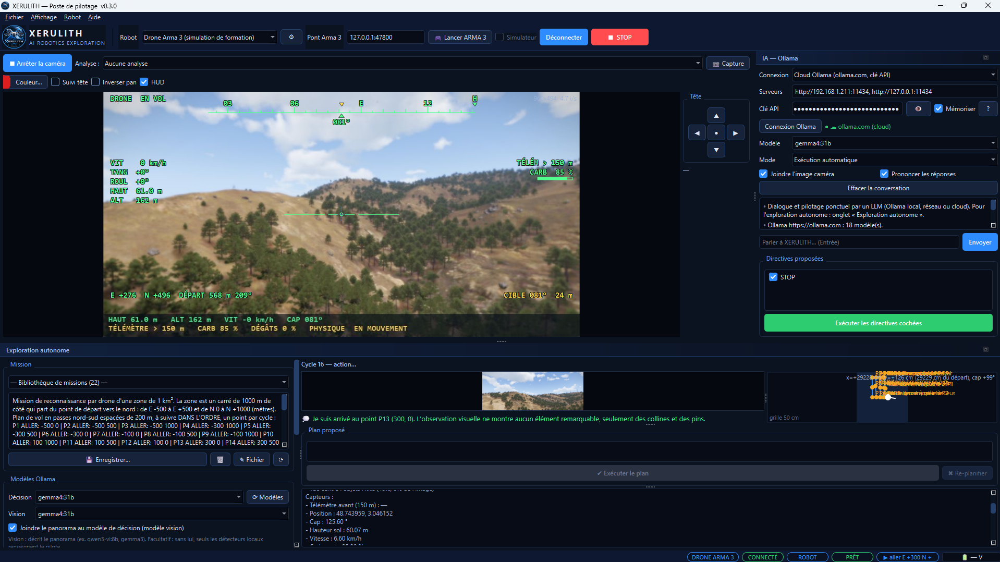<br>
  <i>Mission « Reconnaissance 1 km² » : texte de la mission et plan de vol, pilote IA gemma4:31b (Ollama Cloud) en exécution automatique, cible du trajet sur le HUD.</i>
</p>

Chaque cycle d'exploration se déroule ainsi :

1. **Perception :** la tête balaie à gauche, au centre et à droite pour composer un
   panorama. Les détecteurs locaux cherchent objets, visages et marqueurs ArUco, et le
   modèle vision **qwen3-vl:8b** décrit la scène. Les mesures des capteurs du profil
   (distance, GPS, cap, profondeur) s'ajoutent à l'observation.
2. **Décision :** le modèle **gemma3:12b** reçoit la mission, l'observation, sa mémoire
   et l'historique. Il répond par une pensée et des ordres : `AVANCER`, `TOURNER`,
   `REGARDER`, `DIRE`, `NOTE`, `ACTION`, `FIN`, `MONTER` / `DESCENDRE` pour un sous-marin ou un
   drone, et `ALLER`, `VOLER`, `HAUTEUR`, `VITESSE` pour le drone Arma 3.
3. **Garde-fous :** aucune acrobatie n'est permise et le nombre de pas est plafonné.
   `AVANCER` est refusé si un obstacle proche est détecté, à l'image ou par un télémètre
   sous la distance d'arrêt du profil, et le robot signale s'il est bloqué. L'exploration
   s'arrête si la batterie est trop faible.
4. **Action**, selon le mode choisi :
   - **Confirmer chaque plan** : l'opérateur valide chaque plan avant son exécution ;
   - **Autonome** : le robot exécute seul ;
   - **Observer** : le LLM décide sans que le robot bouge.

Une **bibliothèque de missions** modifiable est fournie, avec 20 missions dans 7 catégories :
découverte, recherche et sauvetage, navigation par repères ArUco, interaction humaine,
surveillance, tests de comportement et drone Arma 3 (formation). Chaque exploration est enregistrée : journal,
panoramas et **rapport de mission** rédigé par le LLM.

#### Exploration et découverte libre d'un robot réel (EZ-Robot JD, rover GalaxyRVR)

Mission **« Exploration et découverte libre (robot réel) »** (catégorie *Découverte*) : la directive première du
robot est de **découvrir des choses nouvelles et d'aller vers elles** pour en apprendre plus, sans parcours imposé.
Adaptée au monde réel :

- **Repères ArUco** (dictionnaire 4×4_50, imprimés à 10 cm de côté : planche `documentations/XERULITH_Reperes_ArUco_10cm.pdf`) posés
  sur le terrain : leur distance est estimée par leur taille à l'image et ils **recalent la position estimée** du
  robot (qui dérive pas après pas). Le robot part toujours **du même point, dans la même direction** (le marqueur
  n° 0 droit devant, par exemple) : c'est le repère commun d'une mission à l'autre.
- **Perception par la caméra** : détecteur d'objets (positions estimées), marqueurs ArUco, description par le modèle
  vision ; **ultrason facultatif**, utilisé automatiquement s'il est déclaré dans le profil (capteur analogique ou
  I2C sur l'EZ-B).
- **Carte de ce qui a été vu** (mailles de 30 cm), gardée dans la mémoire du lieu (`Lieu : …` dans le texte de la
  mission) ; **pistes d'exploration** : objet nouveau à examiner ou terrain jamais vu, avec l'angle dont tourner
  et la distance. `SUIVANT` y emmène, `OBSERVER: n` approche un objet détecté et l'examine.
- **Sécurité d'un bipède** : marche par tronçons de 2 pas ; avant chaque tronçon, arrêt si l'ultrason mesure moins
  que la distance d'arrêt du profil (20 cm au moins), si un objet occupe le bas et le centre de l'image, ou si
  l'image ne change plus depuis 2 tronçons (robot bloqué ou tombé) ; ce qui est derrière un obstacle n'est plus
  proposé ; personnes et animaux observés de loin ; batterie surveillée ; STOP à tout moment.
- **Rapport** : carte (terrain vu, trajet estimé, repères, objets), photos, ce qui a été appris, leçons, et
  **progrès** d'une exploration à l'autre dans le même lieu.

Sans ultrason, seule la caméra protège le robot : un mur ou un obstacle que le détecteur ne reconnaît pas n'est
repéré qu'une fois le robot bloqué. Sol plat et dégagé, opérateur à proximité.

**Avec le rover SunFounder GalaxyRVR** : mission **« Exploration et découverte libre (rover réel GalaxyRVR) »**
(profil *SunFounder GalaxyRVR*). Mieux équipé que le JD pour explorer (ultrason et deux infrarouges de série, six
roues, plus rapide), il fait son **tour d'horizon en tournant sur place** (caméra fixe : une vue tous les 60°
environ, avec une mesure de l'ultrason à chaque cap), au départ et à chaque nouvel endroit atteint ; il **s'arrête
de lui-même en roulant** dès que l'ultrason passe sous la distance d'arrêt ou qu'un infrarouge voit un obstacle ;
tronçons de 1 à 3 pas selon la place mesurée devant. Sa position, estimée par la durée de roulage, dérive davantage
en rotation : étalonner le pas et la rotation sur le sol de l'essai, et poser des repères ArUco à hauteur de sa
caméra. Ni l'ultrason ni les infrarouges ne voient le vide (marche, bord de table).

<p align="center">
  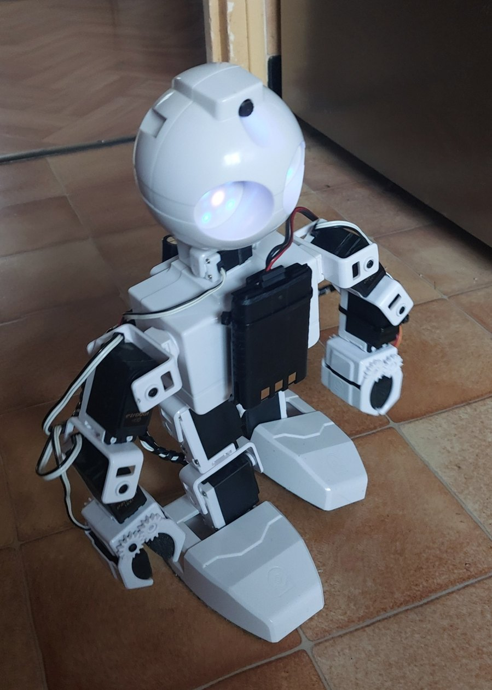
  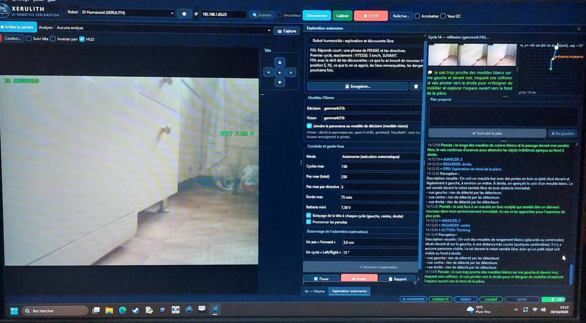<br>
  <i>Exploration du monde réel avec le JD Humanoid (35 cm) : le robot longe les meubles d'une cuisine ; à droite, le poste de pilotage XERULITH (pilote IA gemma4:31b en local), la caméra de tête, le tour d'horizon gauche / centre / droite, la trace estimée et le raisonnement du pilote (« je suis trop proche des meubles blancs, je pivote vers la droite pour explorer l'espace ouvert »).</i>
</p>


## Sécurité

Règles communes à toutes les plateformes : **STOP** (Échap) partout, mouvements limités dans le
temps, positions hors course refusées, batterie minimale et distance d'arrêt du profil, ordres de
l'IA vérifiés, liaison perdue = arrêt. Le bipède JD, sans capteur de position ni de chute, a en plus
ses règles propres :

- **STOP** (ou Échap) arrête le robot au prochain point sûr et **tient** la position. Il
  ne relâche jamais les servos, sinon le robot tombe ;
- **Calibrer** (tous les servos à 90°) est obligatoire avant tout mouvement ;
- une position hors course est **refusée**, jamais rognée ;
- plus aucun mouvement sous **7,20 V**, plus de marche ni d'acrobatie sous **7,45 V** ;
- les acrobaties au sol ne sont possibles qu'avec une autorisation explicite ;
- l'exploration autonome se fait **au sol**, jamais sur une table : le robot ne voit pas le vide.

Pour les autres profils : course de chaque servo déclarée dans le profil (refus hors course),
batterie minimale et distance d'arrêt du profil, véhicule ArduPilot à **armer** explicitement,
consignes RC limitées à la durée d'un pas puis rendues à la radiocommande, et STOP qui remet
roues et moteurs au neutre. Le pont Arma 3 n'écoute que sur le PC local, n'accepte que sept
ordres bornés, arrête le drone si XERULITH se déconnecte, et refuse tout point hors du rayon
autorisé autour du départ.

## Démarrage rapide

1. Installez XERULITH avec son programme d'installation, à paraître (et, pour ArduPilot, Mission Planner OFF-GRID).
   Sans robot, utilisez le raccourci **XERULITH (simulateur)**, le drone Arma 3 ou le simulateur ArduPilot
   (profil **Drone ArduCopter (SITL)**, bouton **🛩 Lancer le simulateur**).
2. Choisissez le **profil** de votre plateforme dans la liste **Robot**.
3. Saisissez l'adresse (IP de l'EZ-B avec **🔍 Scanner**, ci-dessous, `udp:0.0.0.0:14550` pour ArduPilot,
   `192.168.4.1` pour le GalaxyRVR, `127.0.0.1:47800` pour Arma 3…), puis **Connecter**, et
   **Calibrer** si le profil l'exige (JD). Pour une carte EZ-B, **fermez ARC** (un seul client à la fois).

   <p align="center">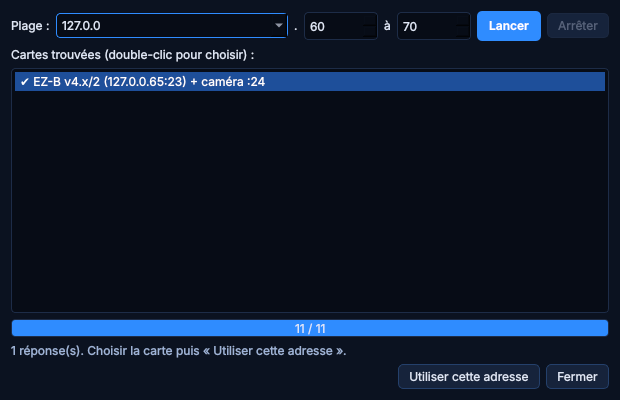<br>
   <i>Recherche de la carte EZ-B sur le réseau (bouton 🔍 Scanner).</i></p>

4. Pour l'IA, il faut un serveur [Ollama](https://ollama.com) sur le réseau ou sur le PC :
   ```
   ollama pull gemma3:12b
   ollama pull qwen3-vl:8b
   ```
   Sans serveur local, choisissez la connexion **Cloud Ollama** dans l'onglet IA et collez
   une clé API créée sur ollama.com (Settings → Keys). La connexion **Automatique** essaie
   le réseau local puis le cloud.
5. Dans l'onglet **Exploration autonome**, choisissez une mission puis cliquez **▶ Démarrer**.

Le [manuel utilisateur](documentations/Manuel_Utilisateur_XERULITH.pdf) détaille chaque panneau,
les profils, le drone Arma 3, l'API des scripts, les directives de l'IA, la configuration
d'Ollama et le dépannage. Le [manuel technique](documentations/XERULITH_Manuel_Technique.pdf)
s'adresse à qui veut décrire un nouveau robot, écrire des missions ou des scripts. La
[fiche simulateur ArduPilot / Mission Planner](documentations/XERULITH_Fiche_Test_SITL_ArduPilot.pdf)
guide pas à pas les essais au simulateur, l'exercice SATER et l'entraînement en terrain connu.

## Configuration requise

| | |
|---|---|
| Système | Windows 10 ou 11, 64 bits |
| Plateforme | Au choix : robot EZ-Robot (carte EZ-B v4, par exemple JD-Humanoid), véhicule ArduPilot (ArduRover, ArduSub, bateau), SunFounder GalaxyRVR, carte maison en série ou TCP ; ou aucune (simulateur intégré, Arma 3) |
| IA (facultatif) | Serveur Ollama sur le réseau ou sur le PC (16 Go de mémoire graphique conseillés pour garder gemma3:12b et qwen3-vl:8b chargés ensemble), ou Ollama Cloud avec une clé API |
| Reconnaissance vocale (facultatif) | Micro du PC |
| Simulation de vol (facultatif) | Arma 3 (Steam) et le mod Pythia, sur le même PC ; deux écrans conseillés |

## Crédits

- Protocole EZ-B v4, bibliothèque de mouvements du JD, détecteurs de vision et simulateur :
  projet [**Commander**](https://github.com/drhalto/commander) de Dustin Hightower,
  licence MIT.
- EZ-Robot, ARC et JD-Humanoid sont des marques d'EZ-Robot Inc. XERULITH n'est pas
  affilié à EZ-Robot.
- Modèles d'IA : [Ollama](https://ollama.com), Gemma 3 (Google), Qwen3-VL (Alibaba).
- MAVLink : [pymavlink](https://github.com/ArduPilot/pymavlink) (ArduPilot, LGPL-3.0).
- Mission Planner OFF-GRID : édition de [Mission Planner](https://github.com/ArduPilot/MissionPlanner)
  (ArduPilot, Michael Oborne, GNU GPL v3), adaptée pour fonctionner sans Internet.
- GalaxyRVR : protocole des projets [galaxy-rvr](https://github.com/sunfounder/galaxy-rvr) et
  [ai-camera-firmware](https://github.com/sunfounder/ai-camera-firmware) de SunFounder.
  SunFounder et GalaxyRVR sont des marques de SunFounder ; XERULITH n'est pas affilié à SunFounder.
- Simulation de vol : mod [Pythia](https://github.com/overfl0/Pythia). Arma 3 est une marque de
  Bohemia Interactive ; XERULITH n'est pas affilié à Bohemia Interactive.

<p align="center">
  <b>by F1GBD (c) 2026 — projet de R&amp;D personnel</b>
</p>

## Licence

XERULITH est un logiciel libre distribué sous licence **GNU GPL v3** (fichier `LICENSE`).
Le projet Commander, utilisé sans modification, reste sous licence MIT (compatible).
